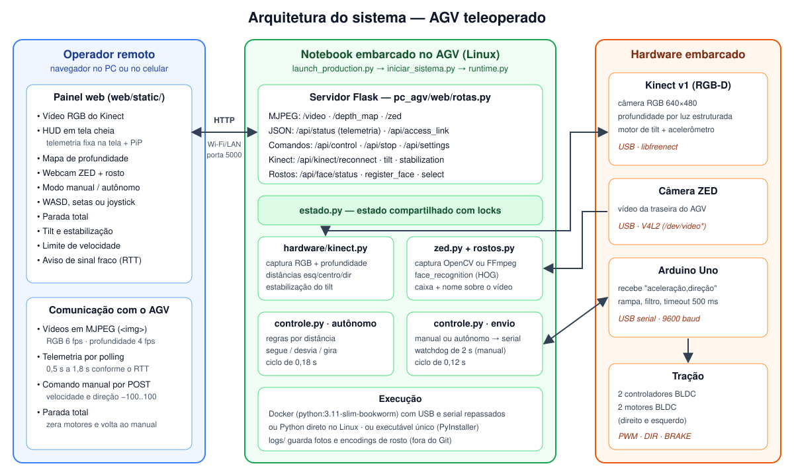
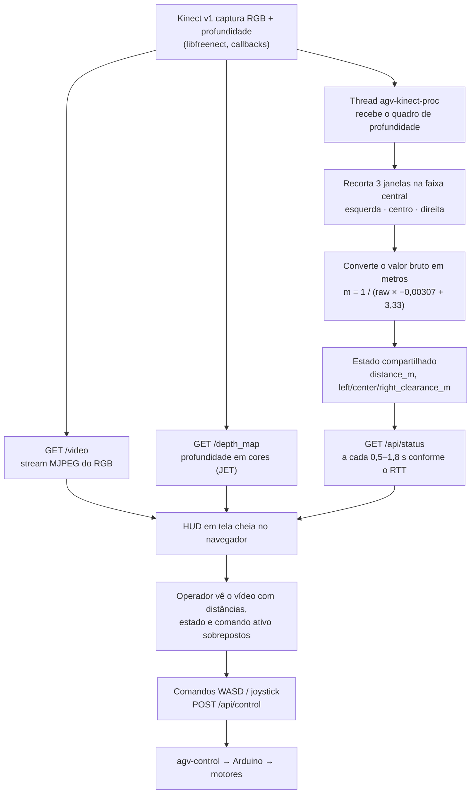
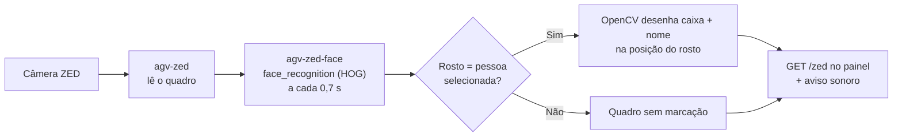
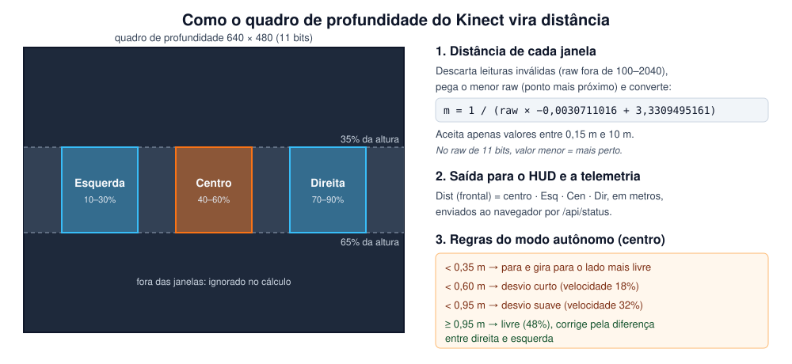
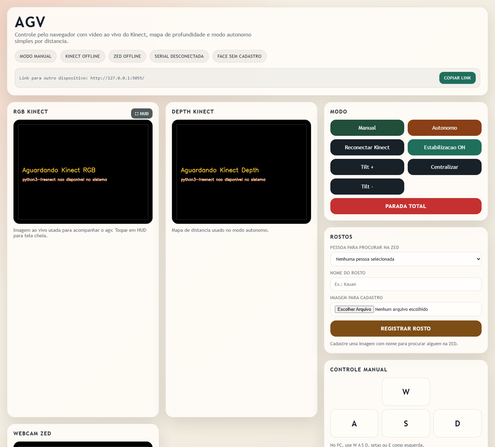
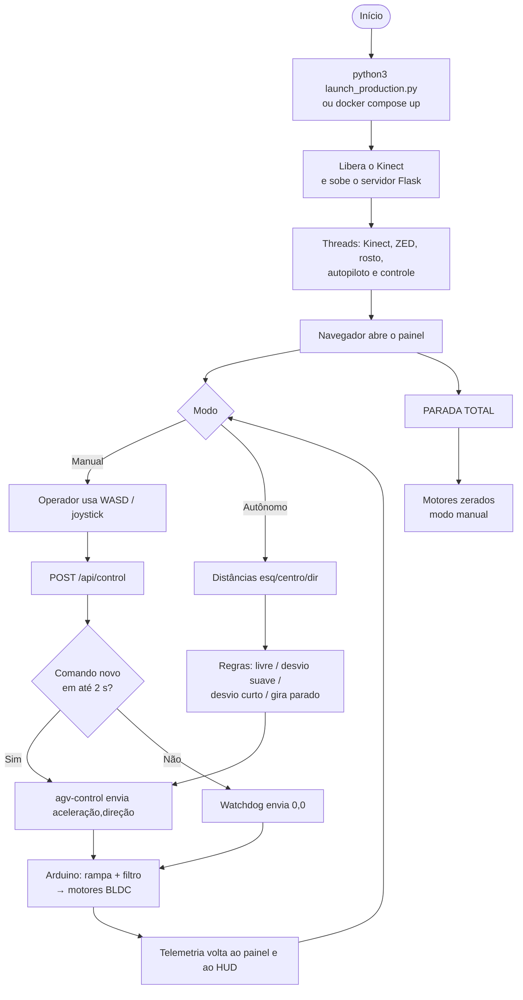
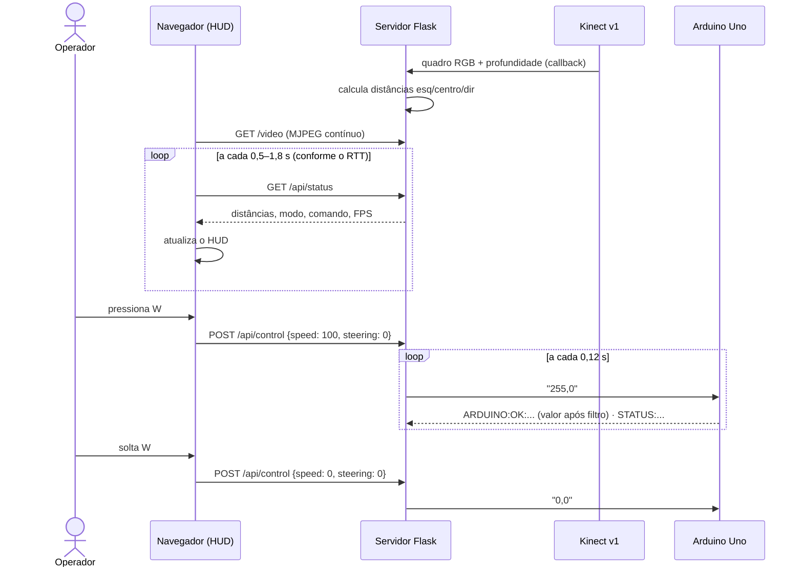
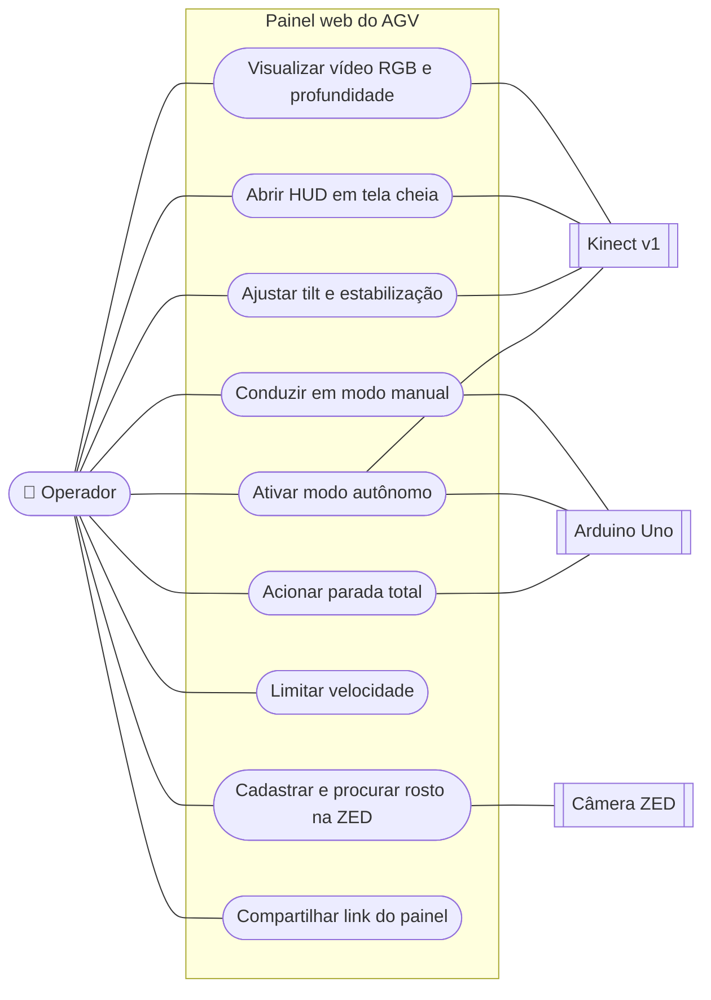
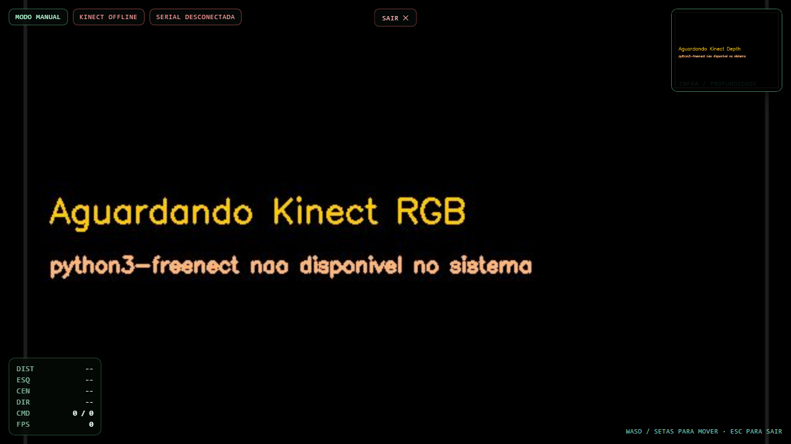

# AGV Teleoperado com Realidade Aumentada

> **UPX — Realidade Aumentada · Centro Universitário Facens**
> Interface web de teleoperação de um AGV (veículo guiado automaticamente) de baixo custo, com vídeo RGB, mapa de profundidade do Kinect v1 e HUD de telemetria sobre o vídeo, base para a pesquisa *"Uso de Realidade Aumentada na teleoperação de um AGV: apoio à navegação remota em intralogística"*.


---

## Sumário

1. [Identificação do Projeto](#1-identificação-do-projeto)
2. [Visão Geral](#2-visão-geral)
3. [Problema](#3-problema)
4. [Objetivos](#4-objetivos)
5. [Público-Alvo](#5-público-alvo)
6. [Funcionalidades](#6-funcionalidades)
7. [Requisitos Não Funcionais](#7-requisitos-não-funcionais)
8. [Tecnologias Utilizadas](#8-tecnologias-utilizadas)
9. [Hardware Utilizado](#9-hardware-utilizado)
10. [Arquitetura do Sistema](#10-arquitetura-do-sistema)
11. [Funcionamento da Realidade Aumentada](#11-funcionamento-da-realidade-aumentada)
12. [Estrutura do Projeto](#12-estrutura-do-projeto)
13. [Principais Scripts e Componentes](#13-principais-scripts-e-componentes)
14. [Dependências](#14-dependências)
15. [Configuração do Ambiente](#15-configuração-do-ambiente)
16. [Como Executar](#16-como-executar)
17. [Como Utilizar a Aplicação](#17-como-utilizar-a-aplicação)
18. [Fluxo de Funcionamento](#18-fluxo-de-funcionamento)
19. [Caso de Uso](#19-caso-de-uso)
20. [Fluxo de Navegação](#20-fluxo-de-navegação)
21. [Interface](#21-interface)
22. [Testes Técnicos](#22-testes-técnicos)
23. [Dispositivos Testados](#23-dispositivos-testados)
24. [Limitações Conhecidas](#24-limitações-conhecidas)
25. [Evidências de Funcionamento](#25-evidências-de-funcionamento)
26. [Repositórios e Recursos](#26-repositórios-e-recursos)
27. [Cronograma Técnico](#27-cronograma-técnico)
28. [Controle de Versão](#28-controle-de-versão)
29. [Problemas Encontrados e Soluções](#29-problemas-encontrados-e-soluções)
30. [Melhorias Futuras](#30-melhorias-futuras)
31. [Custos e Recursos](#31-custos-e-recursos)
32. [Licença](#32-licença)
33. [Autores](#33-autores)

---

## 1. Identificação do Projeto

| Item | Informação |
|---|---|
| **Projeto** | AGV Teleoperado com Realidade Aumentada |
| **Título da pesquisa** | Uso de Realidade Aumentada na teleoperação de um AGV: apoio à navegação remota em intralogística |
| **Equipe** | AGV |
| **Curso** | Engenharia de Computação |
| **Disciplina** | UPX — Realidade Aumentada |
| **Professor** | Prof. Daniel Ohata |
| **Instituição** | Centro Universitário Facens — Sorocaba/SP |
| **Semestre** | 2026.2 |

### Integrantes

| Nome | RA | Responsabilidade |
|---|---|---|
| Jorge Henrique Gobbo Berenschot | 235317 | Scrum Master: organização das sprints e acompanhamento das entregas. ⚠️ PREENCHER: responsabilidades técnicas |
| Kauan Victor Marques | 235003 | Servidor Python/Flask, painel web e HUD de telemetria, integração com Kinect/ZED/Arduino, Docker e organização do repositório |
| Pedro Henrique Santana de Oliveira | 23705 | ⚠️ PREENCHER |
| Gabriel Pelincel Ramalho | 222434 | ⚠️ PREENCHER |
| Felipe Matias de Jesus | 226705 | ⚠️ PREENCHER |

---

## 2. Visão Geral

AGVs (veículos guiados automaticamente) movimentam materiais em armazéns e fábricas. Mesmo quando operam sozinhos, eles **precisam de um operador humano em situações de exceção**: um obstáculo inesperado no corredor, uma área não mapeada ou uma falha de percepção. Nesses momentos o operador assume o veículo **remotamente, olhando apenas para o vídeo da câmera embarcada**. Esse vídeo é plano: dificulta estimar a que distância estão prateleiras, paletes e pessoas, e favorece colisões.

Este projeto é um **AGV de baixo custo** (Kinect v1 como sensor RGB-D, Arduino Uno controlando dois motores BLDC e um notebook Linux embarcado) com uma **interface de teleoperação que roda no navegador**, no PC ou no celular, sem instalar aplicativo. O servidor embarcado transmite o vídeo RGB, o mapa de profundidade e a telemetria, recebe os comandos de direção e os repassa ao Arduino. Há também um modo autônomo simples, que desvia de obstáculos usando a profundidade.

A **Realidade Aumentada entra como exibição por vídeo (*video see-through*)**: o operador vê o ambiente remoto pelo vídeo do Kinect, e o sistema compõe informações virtuais sobre esse vídeo. Hoje isso já existe em duas formas: um **HUD em tela cheia** com distâncias medidas pelo sensor de profundidade (elementos fixos na tela) e uma **caixa com o nome da pessoa reconhecida desenhada sobre ela** no vídeo da câmera ZED (elemento registrado na cena). O próximo passo da pesquisa é **registrar sobre o vídeo os próprios obstáculos**: contorno, distância ancorada e zona de segurança. Em seguida, medir com operadores se isso reduz colisões, tempo e carga de trabalho (ver [síntese da pesquisa](docs/documents/pesquisa-artigo.md)).



---

## 3. Problema

**Contexto.** A intralogística (movimentação interna de materiais em armazéns, centros de distribuição e plantas industriais) usa cada vez mais AGVs e robôs móveis autônomos. Plataformas feitas com microcontroladores, sensores RGB-D de consumo e software aberto estão reduzindo o custo de entrada para pequenas e médias empresas e para instituições de ensino.

**Situação atual.** Quando o AGV para por um obstáculo inesperado, uma área não mapeada ou uma parada de segurança, um operador assume o controle remoto conduzindo o veículo pelo vídeo da câmera embarcada.

**Dificuldade.** A literatura de teleoperação documenta há décadas os problemas desse modo de operação: campo de visão restrito, perda de orientação, **percepção de profundidade prejudicada pela imagem monocular**, vídeo com baixa taxa de quadros e latência entre comando e resposta (Chen, Haas e Barnes, 2007; Fong e Thorpe, 2001). Isso reduz a **consciência situacional** do operador (Endsley, 1995): ele vê o obstáculo, mas não sabe direito a que distância ele está nem se a trajetória atual vai colidir. Os HUDs das plataformas de baixo custo mostram números fixos na tela, sem indicar **onde** está o obstáculo. Já as soluções de RA que fazem isso dependem, em geral, de óculos caros como o HoloLens.

**Público afetado.** Operadores que intervêm remotamente em AGVs; pessoas que dividem o piso com os veículos; empresas de menor porte que não podem pagar por interfaces caras.

**Impacto.** Em um armazém, prateleiras, paletes e pessoas ficam a poucas dezenas de centímetros da trajetória. Uma interface pobre se traduz em **colisões, intervenções mais longas e sobrecarga cognitiva**. O tema se relaciona com o **ODS 8** (meta 8.8, trabalho seguro) e o **ODS 9** (metas 9.4, 9.5 e 9.b, inovação industrial acessível), além das normas **NR-11** e **NR-12**.

---

## 4. Objetivos

### 4.1 Objetivo Geral

Desenvolver e avaliar uma interface de teleoperação baseada em Realidade Aumentada que sobreponha ao vídeo de um AGV informações de profundidade e de obstáculos obtidas por sensor RGB-D, investigando seu efeito no desempenho, na carga de trabalho e na usabilidade percebida por operadores em tarefas de navegação remota em cenário de intralogística.

### 4.2 Objetivos Técnicos

| Objetivo | Como verificar | Status |
|---|---|---|
| Transmitir o vídeo RGB e o mapa de profundidade do Kinect v1 para o navegador | Streams `/video` e `/depth_map` abertos no painel | ✅ |
| Calcular distâncias à esquerda, ao centro e à direita a partir da profundidade | Valores em metros na telemetria e no HUD | ✅ |
| Exibir um HUD de telemetria em tela cheia sobre o vídeo | Botão **⛶ HUD** abre o visualizador | ✅ |
| Permitir condução manual por teclado (PC) e joystick virtual (celular) | AGV responde a W/A/S/D e ao stick | ✅ |
| Garantir parada segura quando a comunicação falha | Watchdog de 2 s no servidor e timeout de 500 ms no Arduino | ✅ |
| Oferecer um modo autônomo simples por profundidade | AGV desvia sozinho em modo **Autônomo** | ✅ |
| Registrar sobre o vídeo o contorno e a distância dos obstáculos | Sobreposição acompanha o obstáculo no vídeo | ⬜ |
| Projetar uma zona de segurança no piso do vídeo | Faixa no piso muda de cor conforme a distância | ⬜ |
| Registrar métricas de experimento (tempo, colisões, RTT, FPS) | Arquivo de log por sessão de teste | ⬜ |
| Avaliar com operadores (SUS e NASA-TLX), HUD × HUD + RA | Dados coletados e analisados | ⬜ |

### 4.3 Questões de pesquisa

- **RQ1:** qual é o efeito das sobreposições de RA registradas no **tempo de conclusão** e no **número de colisões** em um percurso de intralogística?
- **RQ2:** como elas afetam a **carga de trabalho (NASA-TLX)** e a **usabilidade (SUS)**?

Hipóteses, variáveis, ODS e trabalhos relacionados: [docs/documents/pesquisa-artigo.md](docs/documents/pesquisa-artigo.md).

---

## 5. Público-Alvo

| Aspecto | Descrição |
|---|---|
| **Perfil** | Operadores de intralogística e técnicos que precisam intervir remotamente em um AGV; nos experimentos da pesquisa, **operadores não especialistas** |
| **Contexto de uso** | Corredores de armazém ou laboratório, com o AGV em situação de exceção (obstáculo, área não mapeada, parada de segurança) |
| **Necessidades** | Estimar distâncias, perceber obstáculos e antecipar colisões olhando apenas para a tela |
| **Limitações** | Sem acesso visual direto ao AGV; dependem da qualidade do vídeo e da rede Wi-Fi |
| **Familiaridade tecnológica** | Básica: a interface usa navegador comum, teclado (WASD/setas) ou toque, sem instalar nada |

Persona e jornada do usuário, quando elaboradas, ficam em [`docs/documents/`](docs/documents/).

---

## 6. Funcionalidades

| ID | Funcionalidade | Descrição | Status |
|---|---|---|---|
| RF01 | Painel web | Interface de teleoperação servida pelo próprio AGV, aberta em qualquer navegador da mesma rede | ✅ |
| RF02 | Vídeo RGB ao vivo | Stream MJPEG da câmera RGB do Kinect v1 | ✅ |
| RF03 | Mapa de profundidade | Profundidade do Kinect colorida (mapa *JET*: quente = perto) | ✅ |
| RF04 | Telemetria de distâncias | Distância frontal e folgas à esquerda, ao centro e à direita, em metros | ✅ |
| RF05 | HUD em tela cheia | Vídeo RGB em tela cheia com estado do sistema, distâncias, comando ativo, FPS e miniatura da profundidade | ✅ |
| RF06 | Controle por teclado | W/↑ frente, S/↓ ré, A/←/E esquerda, D/→ direita | ✅ |
| RF07 | Joystick virtual | Stick de toque no celular, também disponível dentro do HUD | ✅ |
| RF08 | Modo autônomo | Segue em frente e desvia para o lado mais livre usando a profundidade | ✅ |
| RF09 | Parada total | Zera os motores e volta ao modo manual | ✅ |
| RF10 | Watchdog de segurança | Servidor para o AGV sem comando manual novo em 2 s; Arduino para sem comando em 500 ms | ✅ |
| RF11 | Limite de velocidade | Controle deslizante de 0 a 100% do PWM máximo | ✅ |
| RF12 | Tilt do Kinect | Botões Tilt +/−/Centralizar e estabilização automática pelo acelerômetro | ✅ |
| RF13 | Reconectar Kinect | Libera os drivers do kernel que prendem o Kinect e reinicia a captura | ✅ |
| RF14 | Câmera ZED | Stream da câmera ZED para monitorar a traseira do AGV | ✅ |
| RF15 | Reconhecimento facial | Cadastro de rostos por foto; a pessoa escolhida recebe caixa e nome sobre o vídeo da ZED, com aviso sonoro | ✅ |
| RF16 | Link para outro dispositivo | Mostra e copia o endereço do painel na rede local | ✅ |
| RF17 | Aviso de sinal fraco | Faixa de alerta quando o RTT passa de 800 ms; atualização da telemetria se adapta à rede | ✅ |
| RF18 | Modo escuro | Tema escuro salvo no navegador | ✅ |
| RF19 | Empacotamento | Execução por Docker ou como executável único (PyInstaller) | ✅ |
| RF20 | Contorno de obstáculos (RA registrada) | Desenhar sobre o vídeo RGB o contorno dos obstáculos detectados na profundidade | ⬜ |
| RF21 | Distância ancorada (RA registrada) | Mostrar a distância junto ao obstáculo, acompanhando-o no vídeo | ⬜ |
| RF22 | Zona de segurança (RA registrada) | Faixa projetada no piso do vídeo indicando a área de risco à frente do AGV | ⬜ |
| RF23 | Alinhamento RGB × profundidade | Registrar o mapa de profundidade na imagem RGB (pré-requisito de RF20–RF22) | ⬜ |
| RF24 | Registro do experimento | Gravar tempo, colisões, intervenções, RTT e FPS de cada sessão | ⬜ |
| RF25 | Alternância de condição | Ligar/desligar as sobreposições para comparar HUD × HUD + RA | ⬜ |

**Legenda:** ✅ Implementado · 🚧 Em desenvolvimento · ⬜ Planejado · ❌ Cancelado

---

## 7. Requisitos Não Funcionais

| ID | Categoria | Requisito |
|---|---|---|
| RNF01 | Compatibilidade (operador) | O painel deve funcionar em navegador moderno de PC ou celular, sem instalar aplicativo |
| RNF02 | Plataforma (AGV) | O servidor com hardware roda em Linux x86_64 com libfreenect; no Windows/Mac só é possível visualizar o painel, sem hardware |
| RNF03 | Desempenho | Por padrão os streams são limitados a 6 fps (RGB) e 4 fps (profundidade) para funcionar em Wi-Fi fraco; os valores são configuráveis (`AGV_VIDEO_FPS`, `AGV_DEPTH_FPS`) |
| RNF04 | Conectividade | Operador e AGV devem estar na mesma rede local, porta 5000; não é necessária internet para operar |
| RNF05 | Segurança operacional | O AGV deve parar sozinho se os comandos deixarem de chegar (2 s no servidor, 500 ms no Arduino); o firmware impede inverter o sentido do motor em alta velocidade |
| RNF06 | Disponibilidade | Kinect, ZED e Arduino são reconectados automaticamente; no Docker o container reinicia (`restart: unless-stopped`) |
| RNF07 | Usabilidade | O operador deve conseguir dirigir só com WASD/setas ou com um dedo no joystick; o HUD fecha com **ESC** |
| RNF08 | Privacidade | Fotos e descritores de rosto ficam apenas em `logs/` no notebook do AGV e não são versionados |
| RNF09 | Segurança de rede | O painel não tem autenticação: deve ser usado apenas em rede local confiável |

---

## 8. Tecnologias Utilizadas

| Tecnologia | Versão | Utilização |
|---|---|---|
| Python | 3.11 (imagem `python:3.11-slim-bookworm`; testado com 3.11.9) | Linguagem do servidor e do launcher |
| Flask | ≥ 3.0 (testado 3.1.3) | Servidor web, API REST e streams MJPEG |
| Werkzeug | 3.1.7 (dependência do Flask) | Servidor HTTP multithread usado pelo launcher |
| OpenCV (`opencv-python-headless`) | ≥ 4.8 (testado 4.13.0) | Conversão de cores, mapa de profundidade colorido, JPEG e captura V4L2 da ZED |
| NumPy | ≥ 1.24 (testado 2.2.6) | Cálculo das distâncias sobre o quadro de profundidade |
| face_recognition | ≥ 1.3.0 (testado 1.3.0) | Detecção (HOG) e descritores faciais de 128 dimensões |
| dlib | 20.0.1 (compilado na instalação do face_recognition) | Motor de visão do face_recognition |
| PySerial | ≥ 3.5 (testado 3.5) | Comunicação serial com o Arduino |
| libfreenect / `python3-freenect` | Pacote da distribuição (Debian bookworm na imagem Docker) | Driver do Kinect v1: RGB, profundidade, tilt e acelerômetro |
| FFmpeg | Pacote da distribuição (opcional) | Captura alternativa da ZED quando o OpenCV não abre o dispositivo |
| HTML5, CSS e JavaScript | — (sem frameworks) | Painel web e HUD, embutidos em `HTML_PAGE` |
| Arduino (C++) | ⚠️ PREENCHER: versão da Arduino IDE usada | Firmware de controle dos motores |
| Docker Engine + Compose | Compose v2 (`docker compose`) | Empacotamento e execução no notebook do AGV |
| PyInstaller | 6.x | Executável único `dist/launch_production` |
| Git / GitHub | — | Controle de versão e documentação |

---

## 9. Hardware Utilizado

| Equipamento | Fabricante / modelo | Característica relevante | Utilização |
|---|---|---|---|
| Sensor RGB-D | Microsoft Kinect para Xbox 360 (Kinect v1) ⚠️ CONFERIR modelo | RGB 640×480, profundidade por luz estruturada (11 bits), motor de tilt, acelerômetro; precisa de fonte própria | Vídeo do operador, distâncias e modo autônomo |
| Câmera traseira | Stereolabs ZED ⚠️ CONFERIR modelo | Câmera estéreo USB (V4L2); o reconhecimento usa a metade esquerda do quadro | Vídeo da traseira e reconhecimento facial |
| Microcontrolador | Arduino Uno | Serial USB 9600 baud; PWM nos pinos 5 e 9 | Recebe `aceleração,direção` e aciona os motores |
| Controladores de motor | 2× controlador BLDC YWMJZEU | Entradas PWM, DIR e BRAKE | Potência dos motores direito e esquerdo |
| Motores | 2× motor BLDC ⚠️ PREENCHER modelo | Tração diferencial | Movimento do AGV |
| Computador embarcado | Notebook ⚠️ PREENCHER fabricante/modelo | Linux x86_64 ⚠️ PREENCHER distribuição e versão (ex.: Ubuntu 24.04) | Roda o servidor, Kinect, ZED e serial. Todo o software atual foi desenvolvido, testado e validado nele |
| Dispositivo do operador | ⚠️ PREENCHER (PC e/ou celular usados nos testes) | Navegador com Wi-Fi | Painel web e HUD |

> **Raspberry Pi 5 → notebook.** O AGV foi orçado e construído originalmente para uma Raspberry Pi 5, que queimou durante o desenvolvimento. Ela foi substituída por um notebook Linux embarcado, e tudo o que está neste repositório roda e foi validado no notebook, não na Raspberry Pi (ver [Problema 9](#problema-9--raspberry-pi-5-queimou)).
>
> A tabela só lista equipamentos que o código e o firmware usam.

---

## 10. Arquitetura do Sistema


O sistema tem três partes:

1. **Operador:** abre o painel no navegador. Recebe vídeo por MJPEG e telemetria por JSON, e envia comandos por `POST`.
2. **Notebook embarcado (Linux):** `launch_production.py` sobe o servidor Flask (`pc_agv/iniciar_sistema.py`) no mesmo processo. O servidor roda cinco *threads* independentes, que compartilham estado protegido por *locks*.
3. **Hardware:** Kinect v1 (USB/libfreenect), câmera ZED (USB/V4L2) e Arduino Uno (USB serial), que aciona os controladores BLDC.

### Fluxo resumido

```text
Operador (navegador)
   ↓  HTTP na rede local, porta 5000
Painel web / HUD  ──  vídeo MJPEG + telemetria JSON + comandos POST
   ↓
Servidor Flask (pc_agv/iniciar_sistema.py)
   ├── agv-kinect     → libfreenect → Kinect v1 (RGB + profundidade + tilt)
   ├── agv-zed        → OpenCV/FFmpeg → câmera ZED
   ├── agv-zed-face   → face_recognition
   ├── agv-autopilot  → regras por distância
   └── agv-control    → PySerial → Arduino Uno → controladores BLDC → motores
```

### Threads do servidor

| Thread | Ciclo | Função |
|---|---|---|
| `agv-kinect` (+ `agv-kinect-proc`) | Callback do Kinect | Recebe RGB e profundidade; uma thread separada calcula as distâncias para não travar os callbacks; ajusta o tilt |
| `agv-zed` | Até 60 fps | Abre a ZED (OpenCV V4L2 ou FFmpeg) e desenha a caixa do rosto reconhecido |
| `agv-zed-face` | 0,7 s | Procura a pessoa selecionada no quadro da ZED |
| `agv-autopilot` | 0,18 s | Calcula velocidade e direção no modo autônomo |
| `agv-control` | 0,12 s | Escolhe o comando (manual, autônomo ou watchdog) e envia ao Arduino |

---

## 11. Funcionamento da Realidade Aumentada

### 11.1 Técnica utilizada

| Aspecto | Neste projeto |
|---|---|
| **Tipo de exibição** | RA por vídeo (*video see-through*, Milgram e Kishino, 1994): o mundo é capturado pela câmera do AGV e as informações virtuais são compostas sobre o vídeo, numa tela comum, sem óculos |
| **Abordagem de rastreamento** | *Markerless*, baseada em **sensor de profundidade RGB-D**: não há marcador, QR Code nem detecção de plano por ARCore/ARKit; a geometria da cena vem do mapa de profundidade do Kinect v1 |
| **Reconhecimento** | **Reconhecimento facial** (face_recognition/dlib, HOG) para ancorar a identificação da pessoa sobre o vídeo da ZED |
| **Quem faz o processo** | libfreenect (captura RGB + profundidade), NumPy (distâncias), OpenCV (composição sobre o quadro), navegador (HUD em HTML/CSS sobre o vídeo) |

O projeto distingue dois tipos de elemento virtual (Azuma, 1997):

- **Fixo na tela (*screen-fixed*):** acompanha a interface, não a cena. Exemplo: o HUD com números de distância. **Já implementado.**
- **Registrado (*world-fixed*):** fica ancorado a um ponto da cena e se move com ela. Exemplo: a caixa com o nome sobre o rosto na ZED (**já implementado**) e o contorno/distância sobre o obstáculo no vídeo do Kinect (**planejado**, foco da pesquisa).

### 11.2 Fluxo técnico atual





### 11.3 Como a profundidade vira distância



1. O Kinect entrega um quadro de profundidade 640×480 em 11 bits.
2. O servidor considera só a faixa entre 35% e 65% da altura e recorta **três janelas**: esquerda (10–30% da largura), centro (40–60%) e direita (70–90%).
3. Em cada janela descarta leituras inválidas, pega um valor representativo e o converte em metros pela fórmula da comunidade OpenKinect. Só aceita valores entre 0,15 m e 10 m.
4. A **distância frontal** é a da janela central. Se ela não existir, usa a menor das três.
5. Esses valores vão para a telemetria, para o HUD e para as regras do modo autônomo.

### 11.4 Elementos virtuais

| Elemento | Tipo | Onde aparece | Status |
|---|---|---|---|
| Chips de estado (modo, Kinect, serial) | Fixo na tela | Topo do HUD | ✅ |
| Distâncias Dist/Esq/Cen/Dir, comando ativo e FPS | Fixo na tela | Canto inferior esquerdo do HUD | ✅ |
| Miniatura do mapa de profundidade (PiP) | Fixo na tela | Canto superior direito do HUD | ✅ |
| Joystick virtual (celular) | Fixo na tela | Sobre o vídeo, dentro do HUD | ✅ |
| Caixa + nome da pessoa reconhecida | **Registrado** | Sobre o rosto, no vídeo da ZED | ✅ |
| Contorno do obstáculo | **Registrado** | Sobre o obstáculo, no vídeo RGB | ⬜ |
| Distância ancorada ao obstáculo | **Registrado** | Junto ao obstáculo | ⬜ |
| Zona de segurança no piso | **Registrado** | À frente do AGV, no piso do vídeo | ⬜ |

---

## 12. Estrutura do Projeto

```text
AGV/
├── arduino/
│   └── sketch_may13a/
│       └── sketch_may13a.ino      # firmware do Arduino Uno (motores)
├── pc_agv/
│   ├── __init__.py
│   └── iniciar_sistema.py         # servidor Flask + painel web/HUD + threads
├── tests/
│   ├── test_arduino_serial.py     # testes da serial e do protocolo
│   └── test_kinect_release.py     # testes de liberação USB e tilt do Kinect
├── docs/
│   ├── diagrams/                  # arquitetura e janelas de profundidade (SVG)
│   ├── documents/                 # síntese do artigo científico
│   └── images/                    # capturas de tela do painel e do HUD
├── logs/                          # fotos e encodings de rosto gerados em runtime (fora do Git)
├── launch_production.py           # ponto de entrada: sobe o servidor e abre o navegador
├── launch_production.spec         # receita do PyInstaller (executável único)
├── requirements.txt               # dependências Python
├── Dockerfile                     # imagem python:3.11-slim-bookworm + libfreenect
├── docker-compose.yml             # execução no notebook do AGV (Linux, com hardware)
├── docker-compose.windows.yml     # só o painel, sem hardware (Docker Desktop)
├── CHANGELOG.md
├── LICENSE
└── README.md
```

| Pasta / arquivo | Finalidade |
|---|---|
| `pc_agv/` | Todo o software que roda no notebook do AGV: servidor, API, captura, controle e a página do painel |
| `arduino/` | Firmware que recebe os comandos pela serial e aciona os controladores BLDC |
| `tests/` | Testes automatizados (`unittest`) que rodam sem o hardware conectado |
| `docs/diagrams/` | Diagramas técnicos do projeto atual |
| `docs/images/` | Capturas de tela da interface |
| `docs/documents/` | Material da pesquisa (síntese do artigo) |
| `logs/` | Dados gerados em execução: `encodings.pkl` e fotos de rosto. Ignorado pelo Git |

---

## 13. Principais Scripts e Componentes

| Arquivo / componente | Responsabilidade |
|---|---|
| `launch_production.py` | Garante instância única, abre um terminal visível para os logs, libera o Kinect, sobe o servidor, espera `/api/status` responder e abre o navegador |
| `pc_agv/iniciar_sistema.py` → `AGVServerController` | Cria o servidor HTTP multithread e inicia/para as threads do runtime |
| `_capture_loop` / `_compute_depth_metrics` | Captura do Kinect e cálculo das distâncias esquerda/centro/direita |
| `_do_tilt_body` / `_command_kinect_tilt` | Estabilização do tilt pelo acelerômetro e tilt manual |
| `_release_kinect_usb_claims` | Descarrega os módulos do kernel (`gspca_kinect` etc.) que prendem o Kinect |
| `_zed_capture_loop` / `_zed_face_worker_loop` | Captura da ZED e reconhecimento da pessoa selecionada |
| `_compute_autopilot_command` | Regras do modo autônomo por distância |
| `_control_loop` / `_send_to_arduino` | Escolha do comando, watchdog, limite de velocidade e envio serial |
| `_speed_steering_to_payload` | Converte velocidade/direção (−100..100) no protocolo `aceleração,direção` do Arduino |
| `HTML_PAGE` | Painel web completo (HTML/CSS/JS): streams, HUD, teclado, joystick, telemetria e configurações |
| `arduino/.../sketch_may13a.ino` | Firmware: rampa de aceleração, filtro anti-tremor, anti-reversão, timeout de 500 ms, modo degradado e comandos `STOP`, `RESET`, `STATUS`, `PING` |

### API HTTP

| Método | Rota | Uso |
|---|---|---|
| GET | `/` | Painel web |
| GET | `/video` · `/depth_map` · `/zed` | Streams MJPEG (RGB, profundidade, ZED) |
| GET | `/api/status` | Telemetria completa em JSON |
| GET | `/api/access_link` | Endereço do painel na rede local |
| POST | `/api/control` | Modo (`manual`/`auto`), velocidade e direção |
| POST | `/api/stop` | Parada total |
| GET/POST | `/api/settings` | Limite de velocidade (`speed_limit_pct`) |
| POST | `/api/kinect/reconnect` · `/api/kinect/tilt` | Reconectar Kinect e ajustar o tilt |
| GET/POST | `/api/kinect/stabilization` | Ligar/desligar a estabilização |
| GET | `/api/face/status` | Estado do reconhecimento facial |
| POST | `/api/face/register_face` · `/api/face/select` | Cadastrar rosto (foto + nome) e escolher a pessoa |

Exemplo de comando manual:

```bash
curl -X POST http://127.0.0.1:5000/api/control \
  -H 'Content-Type: application/json' \
  -d '{"mode":"manual","speed":55,"steering":0,"source":"curl"}'
```

### Protocolo serial (PC → Arduino)

Formato `aceleração,direção\n`, com aceleração em −255..255 e direção em −254..254:

| Ação no painel | Linha enviada |
|---|---|
| W (frente) | `255,0` |
| A com o AGV parado (gira à esquerda) | `140,-177` |
| W + D (frente virando à direita) | `255,124` |
| W com limite de velocidade em 50% | `127,0` |
| Parado | `0,0` |

---

## 14. Dependências

**Python** ([`requirements.txt`](requirements.txt), instaladas via PyPI):

```text
flask>=3.0
opencv-python-headless>=4.8
numpy>=1.24
pyserial>=3.5
face-recognition>=1.3.0
```

**Sistema (Linux):**

```text
python3-freenect libfreenect-dev libfreenect-bin   # driver do Kinect v1 (OpenKinect)
libusb-1.0-0 udev                                  # acesso USB
build-essential cmake                              # compilar o dlib do face-recognition
ffmpeg                                             # opcional, captura alternativa da ZED
```

| Dependência essencial | Onde obter |
|---|---|
| libfreenect | Repositórios Debian/Ubuntu (`apt`) ou [OpenKinect/libfreenect](https://github.com/OpenKinect/libfreenect) |
| face_recognition / dlib | [PyPI](https://pypi.org/project/face-recognition/) · [ageitgey/face_recognition](https://github.com/ageitgey/face_recognition) |
| Arduino IDE | [arduino.cc/en/software](https://www.arduino.cc/en/software) |
| Docker | [docs.docker.com/engine/install](https://docs.docker.com/engine/install/) |

---

## 15. Configuração do Ambiente

Escolha o cenário. **A** é o caminho recomendado no AGV, **B** é sem Docker e **C** é só para ver o painel em outro computador.

### A) Notebook do AGV (Linux) com Docker — recomendado

1. Instale o Git e o Docker Engine com o plugin Compose:

   ```bash
   sudo apt update && sudo apt install -y git
   # Docker: siga https://docs.docker.com/engine/install/ubuntu/
   ```

2. Clone o repositório:

   ```bash
   git clone https://github.com/Kauan-V-Marques/AGV.git
   cd AGV
   ```

3. Grave o firmware no Arduino (uma vez):
   1. Instale a Arduino IDE.
   2. Abra `arduino/sketch_may13a/sketch_may13a.ino`.
   3. Em **Ferramentas → Placa**, escolha **Arduino Uno** e selecione a porta.
   4. Clique em **Carregar**. O LED 13 pisca 3 vezes ao iniciar.
4. Conecte o Kinect (com a fonte própria ligada) e o Arduino por USB.
5. Confira a porta do Arduino com `ls /dev/ttyACM*`. Se não for `/dev/ttyACM0`, edite `devices` em `docker-compose.yml`.

### B) Notebook do AGV (Linux) sem Docker

```bash
sudo apt update
sudo apt install -y git python3 python3-pip python3-freenect libfreenect-dev libfreenect-bin build-essential cmake ffmpeg
git clone https://github.com/Kauan-V-Marques/AGV.git
cd AGV
pip3 install -r requirements.txt --break-system-packages   # compila o dlib: leva alguns minutos
sudo usermod -aG dialout $USER                              # acesso à serial (refaça o login)
```

> Se preferir um ambiente virtual, crie-o em `.venv` com `python3 -m venv --system-site-packages .venv`. O `python3-freenect` vem do sistema, e o launcher usa `.venv` automaticamente se ela existir.

### C) Windows ou Mac — só visualizar o painel (sem hardware)

1. Instale o [Docker Desktop](https://www.docker.com/products/docker-desktop/) (no Windows, com backend WSL2).
2. Clone o repositório e use o compose sem hardware (passo 16.C).

### Configurações opcionais (variáveis de ambiente)

| Variável | Padrão | Uso |
|---|---|---|
| `AGV_HOST` / `AGV_PORT` | `0.0.0.0` / `5000` | Interface e porta HTTP |
| `AGV_ARDUINO_PORT` | automática | Porta serial fixa (ex.: `/dev/ttyACM1`) |
| `AGV_ARDUINO_BAUD` | `9600` | Baud rate do Arduino |
| `AGV_ARDUINO_ENABLED` | `1` | `0` desliga a serial |
| `AGV_VIDEO_FPS` / `AGV_DEPTH_FPS` | `6` / `4` | FPS dos streams |
| `AGV_WATCHDOG_TIMEOUT_S` | `2.0` | Tempo sem comando manual até parar (`0` desativa) |
| `AGV_SPEED_LIMIT_PCT` | `100` | Limite inicial de velocidade |
| `AGV_KINECT_STABILIZATION` | `1` | Estabilização do tilt |
| `AGV_ZED_DEVICE` | `/dev/video0` | Dispositivo da câmera ZED |
| `AGV_FACE_DETECT_MODEL` | `hog` | `cnn` é mais preciso e muito mais lento |

---

## 16. Como Executar

```bash
git clone https://github.com/Kauan-V-Marques/AGV.git
cd AGV
```

### A) No AGV, com Docker

```bash
docker compose up --build        # a 1ª build compila o dlib e demora
```

- Em segundo plano: `docker compose up -d --build`. Logs: `docker compose logs -f`. Parar: `docker compose down`.
- Acesse `http://localhost:5000` no próprio AGV ou `http://IP_DO_AGV:5000` de outro dispositivo da rede. O endereço aparece no topo do painel.

### B) No AGV, sem Docker

```bash
python3 launch_production.py
```

O launcher libera o Kinect, sobe o servidor, espera a API responder (até 25 s), abre `http://127.0.0.1:5000` no navegador e mantém os logs no terminal. **Ctrl+C** encerra.

### C) Windows/Mac, só o painel

```bash
docker compose -f docker-compose.windows.yml up --build
```

Acesse `http://localhost:5000`. Os vídeos mostram "Aguardando Kinect/ZED" e a serial fica desativada: é o comportamento esperado sem hardware.

### D) Desenvolvimento e testes (qualquer sistema com Python 3.11)

```bash
pip install -r requirements.txt
python -m unittest discover -s tests -v    # testes automatizados
python -m pc_agv.iniciar_sistema           # só o servidor, sem o launcher (que é exclusivo de Linux)
```

> No Windows, o `pip` compila o dlib: é preciso ter o [CMake](https://cmake.org/download/) e o *Visual Studio Build Tools* (C++) instalados.

### E) Gerar o executável único (Linux)

```bash
pip3 install pyinstaller --break-system-packages
pyinstaller launch_production.spec
./dist/launch_production
```

---

## 17. Como Utilizar a Aplicação

1. **Ligue o AGV** e inicie o sistema (seção 16). O navegador abre o painel.
2. **Confira os indicadores do topo:** `kinect online`, `serial conectada` e `zed online`. Se o Kinect estiver offline, clique em **Reconectar Kinect**.
3. **Para dirigir de outro dispositivo:** clique em **Copiar link** e abra o endereço no PC ou celular do operador, na mesma rede Wi-Fi.
4. **Escolha o modo:** **Manual** (padrão) ou **Autônomo**.
5. **No modo manual:**
   - no PC: **W/↑** frente, **S/↓** ré, **A/←/E** esquerda, **D/→** direita;
   - no celular: arraste o **joystick virtual** e solte para parar.
6. **Abra o HUD:** clique em **⛶ HUD** no card *RGB Kinect*. O vídeo ocupa a tela com as distâncias, o comando ativo, o FPS e a miniatura da profundidade. Saia com **ESC** ou **Sair ✕**.
7. **Ajuste a câmera:** **Tilt +**, **Tilt −** e **Centralizar**; **Estabilização ON/OFF** liga ou desliga o nivelamento automático.
8. **Limite a velocidade** no controle deslizante de *Configurações* antes de manobrar em espaços apertados.
9. **Em qualquer emergência**, clique em **PARADA TOTAL**.
10. *(Opcional)* **Procurar uma pessoa na ZED:** em *Rostos*, informe o nome, escolha uma foto, clique em **Registrar rosto** e selecione a pessoa. Quando ela aparecer na ZED, uma caixa verde com o nome é desenhada sobre o rosto e o painel emite um bipe.



---

## 18. Fluxo de Funcionamento



### Sequência de um comando com o HUD aberto



---

## 19. Caso de Uso



---

## 20. Fluxo de Navegação

```text
Painel principal (http://IP_DO_AGV:5000)
 ├── Topo: estado (modo, Kinect, ZED, serial, rosto) + link para outro dispositivo
 ├── RGB Kinect ──[⛶ HUD]──► Visualizador HUD em tela cheia ──[ESC / Sair ✕]──► Painel principal
 ├── Depth Kinect
 ├── Webcam ZED
 ├── Modo: Manual · Autônomo · Reconectar Kinect · Estabilização · Tilt · PARADA TOTAL
 ├── Rostos: selecionar pessoa · cadastrar nome + foto
 ├── Controle manual: WASD (PC) ou joystick virtual (celular)
 ├── Telemetria: distâncias, comando, Kinect, ZED, Arduino, rosto, FPS
 └── Configurações: modo escuro · velocidade máxima
```

---

## 21. Interface

> Capturas feitas em 14/10/2026 com o servidor rodando **sem hardware conectado** (Windows 10, Microsoft Edge 155). Por isso os vídeos mostram "Aguardando Kinect" e a telemetria aparece vazia. O endereço do painel foi trocado por `127.0.0.1` para não expor a rede local.

### Painel principal


- **Finalidade:** central de teleoperação do AGV.
- **Elementos:** chips de estado, link para outro dispositivo, vídeos RGB/profundidade/ZED, botões de modo e parada total, cadastro de rostos, WASD e joystick, telemetria e configurações.
- **Ação do usuário:** escolher o modo, dirigir, acompanhar a telemetria e abrir o HUD.

### Visualizador HUD em tela cheia



- **Finalidade:** dirigir olhando só para o vídeo, com as informações do sensor sobrepostas.
- **Elementos:** vídeo RGB em tela cheia, chips de modo/Kinect/serial (topo), distâncias Dist/Esq/Cen/Dir, comando e FPS (canto inferior esquerdo), miniatura da profundidade (canto superior direito), dica de teclas e botão **Sair**. No celular, o joystick aparece sobre o vídeo.
- **Ação do usuário:** dirigir com WASD/setas ou joystick; **ESC** fecha.

---

## 22. Testes Técnicos

### 22.1 Testes automatizados (`python -m unittest discover -s tests -v`)

Executados em 14/10/2026 no Windows 10 com Python 3.11.9, sem hardware.

| Teste | Procedimento | Resultado esperado | Resultado obtido | Status |
|---|---|---|---|---|
| Leitura do feedback do Arduino | `FakeSerial` com `ARDUINO:READY/OK/STATUS` | Linhas lidas e erro anterior limpo | Conforme esperado | ✅ |
| Linha `STATUS` limpa erro | `FakeSerial` com `STATUS:0,0,OK,E:0` | `last_error` vira `None` | Conforme esperado | ✅ |
| Descoberta da porta serial | `glob` vazio + `list_ports` simulado | Encontra `/dev/ttyACM0` | Conforme esperado | ✅ |
| Ré envia valor negativo | `_speed_steering_to_payload(-50, 0)` | `(-170, 0)` | Conforme esperado | ✅ |
| Rota de reconexão do Kinect | `POST /api/kinect/reconnect` | 200 e liberação USB chamada | Conforme esperado | ✅ |
| Rotas de tilt e estabilização | `POST /api/kinect/tilt`, `GET/POST /api/kinect/stabilization` | Ângulo e estado repassados | Conforme esperado | ✅ |
| Tilt manual imediato | `_command_kinect_tilt(12)` e `(-12)` | `sync_set_tilt_degs(12)` e `(-12)` | Conforme esperado | ✅ |
| Ordem de liberação dos módulos | `_release_kinect_usb_claims()` | Lista de comandos `sudo` | Teste espera `uvcvideo`, que hoje só é liberado com `AGV_KINECT_RELEASE_UVCVIDEO=1` | ❌ teste desatualizado |
| Correção de tilt pelo acelerômetro / tilt manual com estabilização OFF | `_do_tilt_body` com acelerômetro simulado | `set_tilt_degs` chamado | Erro: os testes precisam do `python3-freenect` instalado (indisponível no Windows) | ⚠️ só em Linux com freenect |

**Resumo:** 12 testes, 9 aprovados, 1 desatualizado e 2 dependentes do `python3-freenect`.

### 22.2 Testes do painel sem hardware

| Teste | Procedimento | Resultado esperado | Resultado obtido | Status |
|---|---|---|---|---|
| Servidor sobe sem hardware | `python -m pc_agv.iniciar_sistema` com `AGV_ARDUINO_ENABLED=0` | Servidor responde | `GET /`, `/api/status`, `/api/face/status` e `/api/settings` retornaram 200 | ✅ |
| Kinect ausente | Abrir o painel sem `python3-freenect` | Mensagem clara no vídeo e na telemetria | "Aguardando Kinect RGB — python3-freenect nao disponivel no sistema" | ✅ |
| ZED ausente | Abrir o painel sem `/dev/video*` | Mensagem no card da ZED | "Aguardando webcam ZED — nao abriu webcam ZED" | ✅ |
| Serial desativada | `AGV_ARDUINO_ENABLED=0` | Telemetria indica serial desligada | "serial desativada por ambiente" | ✅ |
| Abrir o HUD | Clicar em **⛶ HUD** | Vídeo em tela cheia com métricas e PiP | Ver captura na seção 21 | ✅ |

### 22.3 Testes com o AGV

| Teste | Procedimento | Resultado esperado | Resultado obtido | Status |
|---|---|---|---|---|
| Vídeo RGB e profundidade | Iniciar com o Kinect conectado | Vídeos ao vivo no painel | ⚠️ PREENCHER | ⚠️ |
| Distância medida × trena | Obstáculo a 0,5 m, 1 m e 2 m à frente | Valor do HUD próximo da trena | ⚠️ PREENCHER | ⚠️ |
| Condução manual | W/A/S/D no PC e joystick no celular | AGV obedece aos comandos | ⚠️ PREENCHER | ⚠️ |
| Parada total | Clicar em **PARADA TOTAL** em movimento | AGV para imediatamente | ⚠️ PREENCHER | ⚠️ |
| Perda de conexão | Fechar a aba / desligar o Wi-Fi em movimento | AGV para em até 2 s | ⚠️ PREENCHER | ⚠️ |
| Modo autônomo | Obstáculo no caminho em modo **Autônomo** | AGV desvia ou para | ⚠️ PREENCHER | ⚠️ |
| Reconhecimento facial | Cadastrar e selecionar uma pessoa | Caixa e nome sobre o rosto na ZED | ⚠️ PREENCHER | ⚠️ |

---

## 23. Dispositivos Testados

| Dispositivo | Sistema | Versão | Resultado |
|---|---|---|---|
| Notebook de desenvolvimento (navegador Microsoft Edge 155) | Windows 10 Pro | 22H2 (build 19045) | Painel e HUD funcionam sem hardware; launcher não roda (usa `fcntl`, exclusivo de Linux) |
| Notebook embarcado do AGV | ⚠️ PREENCHER | ⚠️ PREENCHER | ⚠️ PREENCHER |
| Celular do operador | ⚠️ PREENCHER | ⚠️ PREENCHER | ⚠️ PREENCHER |

> Só entram aqui dispositivos realmente testados.

---

## 24. Limitações Conhecidas

- **As sobreposições registradas de obstáculos ainda não existem.** O HUD atual mostra números fixos na tela; contorno, distância ancorada e zona de segurança são o próximo passo (RF20–RF22).
- **Profundidade e RGB não estão alinhados entre si.** O Kinect v1 tem as duas câmeras deslocadas, e o código ainda não registra uma sobre a outra; isso é pré-requisito para desenhar sobre o obstáculo no vídeo.
- **Possível erro na escolha do ponto da janela de profundidade.** No formato bruto de 11 bits, `_depth_segment_distance` usa o **maior** valor bruto da janela. Pela fórmula de conversão, valor maior = mais longe. Logo, com um obstáculo próximo na frente de uma parede, a janela tende a informar a distância da parede. Uma janela com algum ponto além de ~10 m é descartada inteira. No formato em milímetros o código usa o menor valor, o comportamento esperado. Precisa ser confirmado com o AGV e corrigido.
- **Watchdog com tecla segurada (a confirmar no AGV):** o painel só envia um comando manual quando ele **muda**, e o servidor para o AGV se não chegar comando novo em 2 s. Pela leitura do código, segurar a mesma tecla (ou o joystick parado na mesma posição) por mais de 2 s deve fazer o AGV parar até o comando mudar.
- **Faixa de medição limitada:** só a faixa central (35–65% da altura) é medida. Obstáculos baixos (paletes no chão) ou altos podem não aparecer nas distâncias.
- **Precisão do Kinect v1 cai com a distância** (Wasenmüller e Stricker, 2016), e ele não mede bem a poucos centímetros nem sob luz solar forte.
- **Vídeo com baixa taxa de quadros** (6 fps RGB, 4 fps profundidade por padrão) para caber em redes fracas, o que aumenta a latência percebida.
- **O modo autônomo é reativo e simples:** regras por limiar, sem mapa nem planejamento de trajetória.
- **Hardware só em Linux:** libfreenect, `/dev/tty*` e o launcher (`fcntl`). No Windows/Mac só é possível ver o painel.
- **Sem autenticação:** qualquer dispositivo da mesma rede pode abrir o painel e comandar o AGV.
- **`sudo` sem senha:** o servidor tenta descarregar `gspca_kinect` com `sudo -n`. Se o sudo pedir senha, isso falha em silêncio; rode `sudo modprobe -r gspca_kinect gspca_main` antes.
- **A imagem Docker não inclui FFmpeg:** dentro do container a ZED só abre pelo OpenCV.
- **1ª build lenta:** o `face-recognition` compila o dlib do código-fonte.
- **RTT não é registrado:** a latência só aparece como aviso na tela; a pesquisa precisa dela em log (RF24).
- **Testes automatizados:** 1 teste desatualizado e 2 que só rodam com `python3-freenect` (seção 22.1).

---

## 25. Evidências de Funcionamento

- Capturas do painel e do HUD em execução: [seção 21](#21-interface).
- ⚠️ PREENCHER: foto do AGV montado (salvar em `docs/images/agv.jpg`).
- ⚠️ PREENCHER: captura do HUD com o vídeo real do Kinect e as distâncias preenchidas (salvar em `docs/images/hud-kinect-real.png`).
- ⚠️ PREENCHER: vídeo de demonstração — `[Assistir demonstração](LINK_DO_VIDEO)`.

---

## 26. Repositórios e Recursos

| Recurso | Link |
|---|---|
| Código-fonte | [github.com/Kauan-V-Marques/AGV](https://github.com/Kauan-V-Marques/AGV) |
| Síntese do artigo | [docs/documents/pesquisa-artigo.md](docs/documents/pesquisa-artigo.md) |
| Modelo de documentação da disciplina | [github.com/dr-ohata/upx-modelo](https://github.com/dr-ohata/upx-modelo) |
| Driver do Kinect v1 | [github.com/OpenKinect/libfreenect](https://github.com/OpenKinect/libfreenect) |
| Vídeo de demonstração | ⚠️ PREENCHER |

---

## 27. Cronograma Técnico

| Atividade | Período | Responsável | Status |
|---|---|---|---|
| Upload inicial do projeto e servidor web | abr/2026 | Kauan | ✅ |
| Integração Kinect, ZED, Arduino e reconhecimento facial (v1.0.2–v1.0.3) | abr–mai/2026 | Kauan · ⚠️ PREENCHER | ✅ |
| Migração da Raspberry Pi 5 (queimada) para notebook Linux embarcado | 2026 | ⚠️ PREENCHER | ✅ |
| Firmware do Arduino reorganizado (v1.0.4) | jul/2026 | ⚠️ PREENCHER | ✅ |
| Docker, organização do repositório e HUD em tela cheia | ago/2026 | Kauan | ✅ |
| Fundamentação teórica e artigo (introdução e trabalhos relacionados) | 2026.2 | Equipe · ⚠️ PREENCHER | ✅ |
| Documentação técnica no padrão da disciplina | out/2026 | Equipe | ✅ |
| Requisitos das sobreposições de RA | 2026.2 | ⚠️ PREENCHER | 🚧 |
| Alinhamento RGB × profundidade e prova de conceito das sobreposições | — | ⚠️ PREENCHER | ⬜ |
| Protótipo experimental estável + registro de métricas | — | ⚠️ PREENCHER | ⬜ |
| Experimento com operadores (SUS e NASA-TLX) | — | Equipe | ⬜ |
| Análise dos resultados e versão final do artigo | — | Equipe | ⬜ |

---

## 28. Controle de Versão

- **Branches e Pull Requests:** as mudanças entram por branches de funcionalidade (`feature/hud-fullscreen-viewer`, `chore/organizar-repositorio`, `docs/readme-modelo-upx`) mescladas na `main` por PR.
- **Commits:** seguem o padrão *Conventional Commits*:

```text
feat: visualizador HUD em tela cheia para o RGB do Kinect
chore: organiza repositorio e corrige build Docker
docs: reformula README no padrao universal
```

- **Marcos de versão:** `v1.0.2`, `v1.0.3` e `v1.0.4` estão registrados nos commits; o histórico de cada versão está no [CHANGELOG.md](CHANGELOG.md). Veja o [histórico completo](https://github.com/Kauan-V-Marques/AGV/commits/main).

---

## 29. Problemas Encontrados e Soluções

### Problema 1 — Kinect ocupado (`LIBUSB_ERROR_BUSY`)

**Problema:** o Kinect não abria pela libfreenect no Linux.
**Causa:** módulos do kernel (`gspca_kinect`, `gspca_main`) assumem o dispositivo como webcam comum.
**Solução:** `_release_kinect_usb_claims` descarrega esses módulos com `modprobe -r`/`rmmod` antes de cada tentativa e no botão **Reconectar Kinect**.

### Problema 2 — Callbacks do Kinect travando

**Problema:** o vídeo engasgava quando o processamento pesado rodava junto da captura.
**Causa:** cálculo de profundidade e reconhecimento facial dentro dos callbacks da libfreenect.
**Solução:** os callbacks só copiam o quadro; uma thread separada (`agv-kinect-proc`) faz o processamento, e o reconhecimento facial roda em sua própria thread (`agv-zed-face`).

### Problema 3 — Painel lento em Wi-Fi fraco

**Problema:** vídeo e comandos atrasavam ou travavam com sinal ruim.
**Causa:** streams pesados e requisições disputando as conexões do navegador.
**Solução:** FPS reduzido (6/4), `Connection: close` nas rotas de API, cancelamento do comando anterior ainda pendente, telemetria com intervalo adaptado ao RTT e aviso de sinal fraco.

### Problema 4 — AGV continuava andando ao perder a conexão

**Problema:** se o navegador fechasse durante o movimento, o último comando podia continuar valendo.
**Causa:** o servidor reenviava o último comando manual indefinidamente.
**Solução:** watchdog de 2 s no servidor, timeout de 500 ms no firmware e parada ao trocar de aba (`blur`).

### Problema 5 — Motores não arrancavam com comandos baixos

**Problema:** com pouca velocidade o AGV não saía do lugar.
**Causa:** PWM baixo não vence a inércia dos motores BLDC.
**Solução:** PWM mínimo de 170 para andar e 140 para girar no lugar (`AGV_MIN_FORWARD_PWM`, `AGV_MIN_TURN_PWM`).

### Problema 6 — Inversão brusca de sentido

**Problema:** trocar de frente para ré em velocidade forçava a mecânica.
**Causa:** o firmware aplicava a nova direção imediatamente.
**Solução:** rampa de aceleração/desaceleração e proteção anti-reversão: o motor só muda de sentido abaixo de PWM 20.

### Problema 7 — Câmera ZED não abria

**Problema:** o OpenCV não abria a ZED em algumas máquinas.
**Causa:** o OpenCV nem sempre consegue abrir o dispositivo V4L2 da ZED.
**Solução:** tentar OpenCV/V4L2 primeiro e, se falhar, FFmpeg (MJPEG direto ou YUYV recodificado), com espera de 20 s antes de repetir um dispositivo que falhou.

### Problema 8 — Docker Desktop sem hardware

**Problema:** `docker compose up` falhava no Windows.
**Causa:** `network_mode: host` e os caminhos `/dev/...` não existem no Docker Desktop.
**Solução:** arquivo `docker-compose.windows.yml` com mapeamento de portas e serial desligada.

### Problema 9 — Raspberry Pi 5 queimou

**Problema:** o computador embarcado original do AGV, uma Raspberry Pi 5, queimou durante o desenvolvimento.
**Causa:** falha de hardware da placa.
**Solução:** substituição por um notebook Linux (x86_64) embarcado no AGV, ligado ao Kinect, à ZED e ao Arduino por USB. Todo o software atual foi desenvolvido, testado e validado no notebook; por isso o executável do PyInstaller usa as bibliotecas `x86_64-linux-gnu`.

---

## 30. Melhorias Futuras

- Alinhar profundidade e RGB e desenhar sobre o vídeo o **contorno dos obstáculos**, a **distância ancorada** e a **zona de segurança no piso**.
- Corrigir a escolha do ponto mais próximo nas janelas de profundidade (seção 24) e ampliar a área medida.
- Registrar em arquivo **tempo, colisões, intervenções, RTT e FPS** de cada sessão.
- Chave para alternar **HUD** × **HUD + RA** durante o experimento.
- Autenticação simples no painel.
- Incluir FFmpeg na imagem Docker.
- Atualizar os testes desatualizados e criar testes para as métricas de profundidade.

---

## 31. Custos e Recursos

| Recurso | Tipo | Custo/Condição |
|---|---|---|
| Python, Flask, OpenCV, NumPy, face_recognition, libfreenect | Software | Gratuito, código aberto |
| Docker Engine | Software | Gratuito no Linux |
| Arduino IDE | Software | Gratuito |
| Kinect v1, câmera ZED, Arduino Uno, controladores e motores BLDC, notebook embarcado | Hardware | ⚠️ PREENCHER: equipamento da equipe ou da instituição |
| Navegador do operador | Software | Gratuito; dispensa óculos de RA |

---

## 32. Licença

Projeto acadêmico desenvolvido na disciplina UPX — Realidade Aumentada do Centro Universitário Facens, distribuído sob a licença **MIT**. Veja [LICENSE](LICENSE).

---

## 33. Autores

- **Jorge Henrique Gobbo Berenschot** (RA 235317): Scrum Master
- **Kauan Victor Marques** (RA 235003): servidor, painel web/HUD e integração do hardware · [GitHub](https://github.com/Kauan-V-Marques)
- **Pedro Henrique Santana de Oliveira** (RA 23705): ⚠️ PREENCHER
- **Gabriel Pelincel Ramalho** (RA 222434): ⚠️ PREENCHER
- **Felipe Matias de Jesus** (RA 226705): ⚠️ PREENCHER

**Orientação:** Prof. Daniel Ohata
**Instituição:** Centro Universitário Facens
**Disciplina:** UPX — Realidade Aumentada
**Semestre:** 2026.2

---

## Checklist de Entrega

- [x] Código-fonte atualizado
- [ ] README completamente preenchido (itens ⚠️ PREENCHER pendentes)
- [x] Versões das tecnologias registradas
- [x] Arquitetura apresentada
- [x] Funcionamento da RA explicado
- [x] Estrutura de pastas documentada
- [x] Scripts principais descritos
- [x] Procedimento de instalação documentado
- [x] Procedimento de execução documentado
- [x] Screenshots reais adicionados (sem hardware)
- [ ] Foto/vídeo do AGV em funcionamento
- [x] Testes automatizados e de painel registrados
- [ ] Testes com o AGV registrados
- [ ] Dispositivos do AGV e do operador informados
- [x] Limitações conhecidas documentadas
- [x] Commits representam a evolução do projeto
