# AGV Teleoperado com Realidade Aumentada

> **UPX — Realidade Aumentada · Centro Universitário Facens**
> Interface web de teleoperação de um AGV (veículo guiado automaticamente) de baixo custo, com vídeo RGB, mapa de profundidade do Kinect v1 e HUD de telemetria sobre o vídeo. O AGV também **aprende a dirigir com o operador** e **mapeia o ambiente sem encoders**. É a base para a pesquisa *"Uso de Realidade Aumentada na teleoperação de um AGV: apoio à navegação remota em intralogística"*.


---

## Sumário

1. [Identificação do Projeto](#1-identificação-do-projeto)
2. [Visão Geral](#2-visão-geral)
3. [Problema](#3-problema)
4. [Objetivos](#4-objetivos)
5. [Público-Alvo](#5-público-alvo)
6. [Funcionalidades](#6-funcionalidades)
7. [Requisitos Não Funcionais](#7-requisitos-não-funcionais)
8. [Tecnologias Utilizadas](#8-tecnologias-utilizadas)
9. [Hardware Utilizado](#9-hardware-utilizado)
10. [Arquitetura do Sistema](#10-arquitetura-do-sistema)
11. [Funcionamento da Realidade Aumentada](#11-funcionamento-da-realidade-aumentada)
12. [Estrutura do Projeto](#12-estrutura-do-projeto)
13. [Principais Scripts e Componentes](#13-principais-scripts-e-componentes)
14. [Dependências](#14-dependências)
15. [Configuração do Ambiente](#15-configuração-do-ambiente)
16. [Como Executar](#16-como-executar)
17. [Como Utilizar a Aplicação](#17-como-utilizar-a-aplicação)
18. [Fluxo de Funcionamento](#18-fluxo-de-funcionamento)
19. [Caso de Uso](#19-caso-de-uso)
20. [Fluxo de Navegação](#20-fluxo-de-navegação)
21. [Interface](#21-interface)
22. [Testes Técnicos](#22-testes-técnicos)
23. [Dispositivos Testados](#23-dispositivos-testados)
24. [Limitações Conhecidas](#24-limitações-conhecidas)
25. [Evidências de Funcionamento](#25-evidências-de-funcionamento)
26. [Repositórios e Recursos](#26-repositórios-e-recursos)
27. [Cronograma Técnico](#27-cronograma-técnico)
28. [Controle de Versão](#28-controle-de-versão)
29. [Problemas Encontrados e Soluções](#29-problemas-encontrados-e-soluções)
30. [Melhorias Futuras](#30-melhorias-futuras)
31. [Custos e Recursos](#31-custos-e-recursos)
32. [Licença](#32-licença)
33. [Autores](#33-autores)

---

## 1. Identificação do Projeto

| Item | Informação |
|---|---|
| **Projeto** | AGV Teleoperado com Realidade Aumentada |
| **Título da pesquisa** | Uso de Realidade Aumentada na teleoperação de um AGV: apoio à navegação remota em intralogística |
| **Equipe** | AGV |
| **Curso** | Engenharia de Computação |
| **Disciplina** | UPX — Realidade Aumentada |
| **Professor** | Prof. Dr. Daniel Ohata |
| **Instituição** | Centro Universitário Facens — Sorocaba/SP |
| **Semestre** | 2026.2 |

### Integrantes

| Nome | RA | Responsabilidade |
|---|---|---|
| Jorge Henrique Gobbo Berenschot | 235317 | Scrum Master (organização das sprints e acompanhamento das entregas); qualidade e experimento: validação, testes, protocolo experimental e atas |
| Kauan Victor Marques | 235003 | Líder da equipe e líder técnico: servidor e integração com o hardware (Kinect, Flask e Arduino), painel web e HUD, sobreposições de RA, testes e documentação técnica |
| Pedro Henrique Santana de Oliveira | 23705 | Hardware e eletrônica (Arduino, chassi e percurso experimental) e documentação |
| Gabriel Pelincel Ramalho | 222434 | Codificação e organização do projeto (refatoração, Docker e Trello) e documentação científica: artigo, planilha de artigos e referências |
| Felipe Matias de Jesus | 226705 | Interface e comunicação: front-end das sobreposições, pitch e slides; documentação |

---

## 2. Visão Geral

AGVs (veículos guiados automaticamente) movimentam materiais em armazéns e fábricas. Mesmo quando operam sozinhos, eles **precisam de um operador humano em situações de exceção**: um obstáculo inesperado no corredor, uma área não mapeada ou uma falha de percepção. Nesses momentos o operador assume o veículo **remotamente, olhando apenas para o vídeo da câmera embarcada**. Esse vídeo é plano: dificulta estimar a que distância estão prateleiras, paletes e pessoas, e favorece colisões.

Este projeto é um **AGV de baixo custo** (Kinect v1 como sensor RGB-D, Arduino Uno controlando dois motores BLDC e um notebook Linux embarcado) com uma **interface de teleoperação que roda no navegador**, no PC ou no celular, sem instalar aplicativo. O servidor embarcado transmite o vídeo RGB, o mapa de profundidade e a telemetria, recebe os comandos de direção e os repassa ao Arduino. Há também um modo autônomo simples, que desvia de obstáculos usando a profundidade.

Duas funções vão além da teleoperação:

- **Auto-aprendizado:** enquanto o operador dirige, o AGV grava o que ele fez diante de cada leitura de profundidade, treina uma rede neural e passa a dirigir sozinho no modo **IA**. Quando a IA erra, o operador corrige pelas mesmas teclas; as correções, as recompensas (avançar com caminho livre) e as penalidades (chegar perto de obstáculo, parada de emergência) entram no treino seguinte.
- **Auto-mapeamento:** sem encoders nas rodas, o AGV estima quanto andou e girou casando as leituras de profundidade do Kinect (odometria visual) e monta um mapa 2D do ambiente, que pode ser salvo e consultado depois.

O que a IA aprende e os mapas salvos ficam em bancos SQLite no notebook e continuam lá depois de desligar o sistema.

A **Realidade Aumentada entra como exibição por vídeo (*video see-through*)**: o operador vê o ambiente remoto pelo vídeo do Kinect, e o sistema compõe informações virtuais sobre esse vídeo. Hoje isso já existe em duas formas: um **HUD em tela cheia** com distâncias medidas pelo sensor de profundidade (elementos fixos na tela) e uma **caixa com o nome da pessoa reconhecida desenhada sobre ela** no vídeo da câmera ZED (elemento registrado na cena). O próximo passo da pesquisa é **registrar sobre o vídeo os próprios obstáculos**: contorno, distância ancorada e zona de segurança. Em seguida, medir com operadores se isso reduz colisões, tempo e carga de trabalho (ver [síntese da pesquisa](docs/documents/pesquisa-artigo.md)).


---

## 3. Problema

**Contexto.** A intralogística (movimentação interna de materiais em armazéns, centros de distribuição e plantas industriais) usa cada vez mais AGVs e robôs móveis autônomos. Plataformas feitas com microcontroladores, sensores RGB-D de consumo e software aberto estão reduzindo o custo de entrada para pequenas e médias empresas e para instituições de ensino.

**Situação atual.** Quando o AGV para por um obstáculo inesperado, uma área não mapeada ou uma parada de segurança, um operador assume o controle remoto conduzindo o veículo pelo vídeo da câmera embarcada.

**Dificuldade.** A literatura de teleoperação documenta há décadas os problemas desse modo de operação: campo de visão restrito, perda de orientação, **percepção de profundidade prejudicada pela imagem monocular**, vídeo com baixa taxa de quadros e latência entre comando e resposta (Chen, Haas e Barnes, 2007; Fong e Thorpe, 2001). Isso reduz a **consciência situacional** do operador (Endsley, 1995): ele vê o obstáculo, mas não sabe direito a que distância ele está nem se a trajetória atual vai colidir. Os HUDs das plataformas de baixo custo mostram números fixos na tela, sem indicar **onde** está o obstáculo. Já as soluções de RA que fazem isso dependem, em geral, de óculos caros como o HoloLens.

**Público afetado.** Operadores que intervêm remotamente em AGVs; pessoas que dividem o piso com os veículos; empresas de menor porte que não podem pagar por interfaces caras.

**Impacto.** Em um armazém, prateleiras, paletes e pessoas ficam a poucas dezenas de centímetros da trajetória. Uma interface pobre se traduz em **colisões, intervenções mais longas e sobrecarga cognitiva**. O tema se relaciona com o **ODS 8** (meta 8.8, trabalho seguro) e o **ODS 9** (metas 9.4, 9.5 e 9.b, inovação industrial acessível), além das normas **NR-11** e **NR-12**.

---

## 4. Objetivos

### 4.1 Objetivo Geral

Desenvolver e avaliar uma interface de teleoperação baseada em Realidade Aumentada que sobreponha ao vídeo de um AGV informações de profundidade e de obstáculos obtidas por sensor RGB-D, investigando seu efeito no desempenho, na carga de trabalho e na usabilidade percebida por operadores em tarefas de navegação remota em cenário de intralogística.

### 4.2 Objetivos Técnicos

| Objetivo | Como verificar | Status |
|---|---|---|
| Transmitir o vídeo RGB e o mapa de profundidade do Kinect v1 para o navegador | Streams `/video` e `/depth_map` abertos no painel | ✅ |
| Calcular distâncias à esquerda, ao centro e à direita a partir da profundidade | Valores em metros na telemetria e no HUD | ✅ |
| Exibir um HUD de telemetria em tela cheia sobre o vídeo | Botão **HUD** na câmera principal abre o visualizador | ✅ |
| Permitir condução manual por teclado (PC) e joystick virtual (celular) | AGV responde a W/A/S/D e ao stick | ✅ |
| Garantir parada segura quando a comunicação falha | Watchdog de 2 s no servidor e timeout de 500 ms no Arduino | ✅ |
| Oferecer um modo autônomo simples por profundidade | AGV desvia sozinho em modo **Autônomo** | ✅ |
| Organizar o painel em seções sem perder funções | Menu lateral: Painel, Câmeras, Telemetria, Aprendizado, Mapa e Configurações | ✅ |
| Aprender a dirigir com o operador e melhorar por recompensa | Modelo treinado na página **Aprendizado**; modo **IA** no controle | ✅ |
| Mapear o ambiente sem encoders (odometria visual pelo Kinect) | Página **Mapa** monta o mapa ao vivo; erro abaixo de 2% do caminho em simulação | ✅ |
| Guardar o aprendizado e os mapas entre execuções | `logs/aprendizado.db` e `logs/mapas.db` (SQLite) | ✅ |
| Registrar sobre o vídeo o contorno e a distância dos obstáculos | Sobreposição acompanha o obstáculo no vídeo | ⬜ |
| Projetar uma zona de segurança no piso do vídeo | Faixa no piso muda de cor conforme a distância | ⬜ |
| Registrar métricas de experimento (tempo, colisões, RTT, FPS) | Arquivo de log por sessão de teste | ⬜ |
| Mostrar um aviso quando a frente não tiver leitura válida (zona não medida) | Aviso no vídeo em vez de omitir a informação | ⬜ |
| Verificar tecnicamente a precisão e a estabilidade do registro | Erro de registro ≤ 10 px e IoU ≥ 0,7; erro de distância ≤ 5% até 2,5 m; desvio ≤ 3 px parado; persistência ≥ 95%; queda de FPS < 10% | ⬜ |
| Avaliar com operadores (SUS e NASA-TLX), HUD × HUD + RA | 20 operadores, desenho intrassujeitos contrabalanceado; dados coletados e analisados | ⬜ |

### 4.3 Questões de pesquisa

- **RQ1:** qual é o efeito das sobreposições de RA registradas no **tempo de conclusão** e no **número de colisões** em um percurso de intralogística?
- **RQ2:** como elas afetam a **carga de trabalho (NASA-TLX)** e a **usabilidade (SUS)**?

### 4.4 Etapas da pesquisa

A pesquisa é aplicada, predominantemente explicativa e de abordagem mista: mede o desempenho e a percepção dos operadores e complementa com observação e entrevista. As etapas seguem os objetivos específicos do artigo (versão 2, de 14/10/2026):

1. Comparar trabalhos que empregam RA e interfaces espaciais na teleoperação de robôs móveis.
2. Definir os requisitos das sobreposições e o método de registro a partir do mapa de profundidade.
3. Desenvolver o protótipo integrado ao servidor de teleoperação existente.
4. Verificar tecnicamente a precisão e a estabilidade do registro, com critérios de aceitação definidos antes do estudo com usuários.
5. Submeter o protocolo ao Comitê de Ética em Pesquisa e realizar um estudo piloto com dois participantes externos à amostra.
6. Conduzir o experimento com 20 operadores não especialistas, em desenho intrassujeitos: cada um usa as duas interfaces (HUD fixo e HUD + RA), com a ordem e os dois percursos equivalentes contrabalanceados.
7. Analisar os resultados à luz das hipóteses.

Hipóteses, variáveis, desenho experimental, avaliação técnica, ODS e trabalhos relacionados: [docs/documents/pesquisa-artigo.md](docs/documents/pesquisa-artigo.md).

---

## 5. Público-Alvo

| Aspecto | Descrição |
|---|---|
| **Perfil** | Operadores de intralogística e técnicos que precisam intervir remotamente em um AGV; nos experimentos da pesquisa, **operadores não especialistas** |
| **Contexto de uso** | Corredores de armazém ou laboratório, com o AGV em situação de exceção (obstáculo, área não mapeada, parada de segurança) |
| **Necessidades** | Estimar distâncias, perceber obstáculos e antecipar colisões olhando apenas para a tela |
| **Outros interessados** | Pesquisadores e projetistas de sistemas de interação humano-robô; pequenas e médias empresas que buscam automação industrial acessível; laboratórios e cursos de robótica que usam plataformas de baixo custo |
| **Limitações** | Sem acesso visual direto ao AGV; dependem da qualidade do vídeo e da rede Wi-Fi |
| **Familiaridade tecnológica** | Básica: a interface usa navegador comum, teclado (WASD/setas) ou toque, sem instalar nada |

Persona e jornada do usuário, quando elaboradas, ficam em [`docs/documents/`](docs/documents/).

---

## 6. Funcionalidades

| ID | Funcionalidade | Descrição | Status |
|---|---|---|---|
| RF01 | Painel web | Interface de teleoperação servida pelo próprio AGV, aberta em qualquer navegador da mesma rede e organizada por um menu lateral: Painel, Câmeras, Telemetria, Aprendizado, Mapa e Configurações | ✅ |
| RF02 | Vídeo RGB ao vivo | Stream MJPEG da câmera RGB do Kinect v1 | ✅ |
| RF03 | Mapa de profundidade | Profundidade do Kinect colorida (mapa *JET*: quente = perto) | ✅ |
| RF04 | Telemetria de distâncias | Distância frontal e folgas à esquerda, ao centro e à direita, em metros | ✅ |
| RF05 | HUD em tela cheia | Vídeo RGB em tela cheia com estado do sistema, distâncias, comando ativo, FPS e miniatura da profundidade | ✅ |
| RF06 | Controle por teclado | W/↑ frente, S/↓ ré, A/←/E esquerda, D/→ direita | ✅ |
| RF07 | Joystick virtual | Stick de toque no celular, também disponível dentro do HUD | ✅ |
| RF08 | Modo autônomo | Segue em frente e desvia para o lado mais livre usando a profundidade (regras por distância) | ✅ |
| RF09 | Parada total | Zera os motores e volta ao modo manual | ✅ |
| RF10 | Watchdog de segurança | Servidor para o AGV sem comando manual novo em 2 s; Arduino para sem comando em 500 ms | ✅ |
| RF11 | Limite de velocidade | Controle deslizante de 0 a 100% do PWM máximo | ✅ |
| RF12 | Tilt do Kinect | Botões Tilt +/−/Centralizar e estabilização automática pelo acelerômetro | ✅ |
| RF13 | Reconectar Kinect | Libera os drivers do kernel que prendem o Kinect e reinicia a captura | ✅ |
| RF14 | Câmera ZED | Stream da câmera ZED para monitorar a traseira do AGV | ✅ |
| RF15 | Reconhecimento facial | Cadastro de rostos por foto; a pessoa escolhida recebe caixa e nome sobre o vídeo da ZED, com aviso sonoro | ✅ |
| RF16 | Link para outro dispositivo | Mostra e copia o endereço do painel na rede local | ✅ |
| RF17 | Aviso de sinal fraco | Faixa de alerta quando o RTT passa de 800 ms; atualização da telemetria se adapta à rede | ✅ |
| RF18 | Tema escuro e claro | Alternância no menu lateral, lembrada pelo navegador | ✅ |
| RF19 | Empacotamento | Execução por Docker ou como executável único (PyInstaller) | ✅ |
| RF20 | Foto e troca de câmera | Botão **Foto** salva um PNG do vídeo principal; clicar numa miniatura a troca com o vídeo principal, e a escolha é lembrada em cada seção | ✅ |
| RF21 | Proximidade e gráfico | Setores coloridos à esquerda, à frente e à direita do AGV e gráfico das distâncias dos últimos 60 s com os limites do autônomo | ✅ |
| RF22 | Telemetria geral e avisos | Resumo de 8 indicadores no painel e avisos na tela (no lugar das janelas `alert()` do navegador) | ✅ |
| RF23 | Gravação de exemplos | No modo manual, 5 vezes por segundo, guarda a profundidade (miniatura 24×32) e o comando do operador; ignora o AGV parado sem motivo e o watchdog | ✅ |
| RF24 | Treino da rede neural | Botão **Treinar agora** e treino automático a cada 400 exemplos novos com o AGV parado; curva de treino e acerto medidos contra o operador | ✅ |
| RF25 | Modo IA | O AGV dirige pelo modelo treinado; a camada de segurança bloqueia o avanço a menos de 0,35 m, limita a 25% a menos de 0,60 m, limita a ré a 30% e respeita a velocidade máxima da IA | ✅ |
| RF26 | Correção do operador | No modo IA, uma tecla ou o joystick vale como correção por 1 s; a correção é obedecida na hora e vira exemplo com peso dobrado | ✅ |
| RF27 | Aprendizado por recompensa | O treino pesa as ações da própria IA pela recompensa: avançar com caminho livre soma; chegar perto de obstáculo, ser corrigida ou causar parada de emergência subtrai | ✅ |
| RF28 | Modelos salvos | Os 10 últimos modelos ficam guardados; dá para voltar a um anterior e apagar os exemplos ou tudo | ✅ |
| RF29 | Odometria visual | Posição e direção do AGV estimadas casando varreduras da profundidade (ICP), sem encoders | ✅ |
| RF30 | Mapa ao vivo | Mapa de ocupação (células de 5 cm) com trajeto, varredura atual, AGV e campo de visão do Kinect; zoom, arrasto e seguir o AGV | ✅ |
| RF31 | Mapas salvos | Salvar com nome, abrir para consulta e apagar | ✅ |
| RF32 | Persistência | Exemplos, modelos, mapas e ajustes em SQLite (`logs/`), mantidos entre execuções | ✅ |
| RF33 | Contorno de obstáculos (RA registrada) | Desenhar sobre o vídeo RGB o contorno dos obstáculos detectados na profundidade | ⬜ |
| RF34 | Distância ancorada (RA registrada) | Mostrar a distância junto ao obstáculo, acompanhando-o no vídeo | ⬜ |
| RF35 | Zona de segurança (RA registrada) | Faixa projetada no piso do vídeo indicando a área de risco à frente do AGV | ⬜ |
| RF36 | Alinhamento RGB × profundidade | Registrar o mapa de profundidade na imagem RGB (pré-requisito de RF33–RF35) | ⬜ |
| RF37 | Registro do experimento | Gravar tempo, colisões, intervenções, RTT e FPS de cada sessão, com as paradas por falha técnica (perda de vídeo, watchdog, queda de comunicação) registradas à parte | ⬜ |
| RF38 | Alternância de condição | Ligar/desligar as sobreposições para comparar HUD × HUD + RA, com o mesmo processamento no servidor nas duas condições | ⬜ |
| RF39 | Aviso de zona não medida | Quando a região à frente não tiver leitura válida (abaixo do alcance mínimo do Kinect), mostrar um aviso no vídeo em vez de omitir a informação | ⬜ |

**Legenda:** ✅ Implementado · 🚧 Em desenvolvimento · ⬜ Planejado · ❌ Cancelado

---

## 7. Requisitos Não Funcionais

| ID | Categoria | Requisito |
|---|---|---|
| RNF01 | Compatibilidade (operador) | O painel deve funcionar em navegador moderno de PC ou celular, sem instalar aplicativo |
| RNF02 | Plataforma (AGV) | O servidor com hardware roda em Linux x86_64 com libfreenect; no Windows/Mac só é possível visualizar o painel, sem hardware |
| RNF03 | Desempenho | Por padrão os streams são limitados a 6 fps (RGB) e 4 fps (profundidade) para funcionar em Wi-Fi fraco; os valores são configuráveis (`AGV_VIDEO_FPS`, `AGV_DEPTH_FPS`) |
| RNF04 | Conectividade | Operador e AGV devem estar na mesma rede local, porta 5000; não é necessária internet para operar |
| RNF05 | Segurança operacional | O AGV deve parar sozinho se os comandos deixarem de chegar (2 s no servidor, 500 ms no Arduino); o firmware impede inverter o sentido do motor em alta velocidade |
| RNF06 | Disponibilidade | Kinect, ZED e Arduino são reconectados automaticamente; no Docker o container reinicia (`restart: unless-stopped`) |
| RNF07 | Usabilidade | O operador deve conseguir dirigir só com WASD/setas ou com um dedo no joystick; o HUD fecha com **ESC** |
| RNF08 | Privacidade | Fotos e descritores de rosto ficam apenas em `logs/` no notebook do AGV e não são versionados; o aprendizado guarda só miniaturas de profundidade, sem imagens das câmeras |
| RNF09 | Segurança de rede | O painel não tem autenticação: deve ser usado apenas em rede local confiável |
| RNF10 | Persistência | Aprendizado e mapas em SQLite (`logs/aprendizado.db`, `logs/mapas.db`); um banco ilegível desliga só aquele recurso, sem apagar o arquivo |
| RNF11 | Desempenho | Gravação de exemplos e decisão da IA em cerca de 3 ms por quadro; mapeamento em 16 a 38 ms por quadro a 4 quadros/s (medido em simulação, seção 22.3). Sem dependências pesadas: NumPy puro |
| RNF12 | Segurança da IA | A rede nunca comanda os motores direto: passa pela camada de segurança, e o operador pode corrigir ou acionar a parada de emergência a qualquer momento |

---

## 8. Tecnologias Utilizadas

| Tecnologia | Versão | Utilização |
|---|---|---|
| Python | 3.11 (imagem `python:3.11-slim-bookworm`; testado com 3.11.9) | Linguagem do servidor e do launcher |
| Flask | ≥ 3.0 (testado 3.1.3) | Servidor web, API REST e streams MJPEG |
| Werkzeug | 3.1.7 (dependência do Flask) | Servidor HTTP multithread usado pelo launcher |
| OpenCV (`opencv-python-headless`) | ≥ 4.8 (testado 4.13.0) | Conversão de cores, mapa de profundidade colorido, JPEG e captura V4L2 da ZED |
| NumPy | ≥ 1.24 (testado 2.2.6) | Distâncias da profundidade, rede neural do auto-aprendizado e ICP do auto-mapeamento |
| face_recognition | ≥ 1.3.0 (testado 1.3.0) | Detecção (HOG) e descritores faciais de 128 dimensões |
| dlib | 20.0.1 (compilado na instalação do face_recognition) | Motor de visão do face_recognition |
| PySerial | ≥ 3.5 (testado 3.5) | Comunicação serial com o Arduino |
| libfreenect | 0.5.3 (apt: `libfreenect-dev`) | Biblioteca C do Kinect v1 |
| Driver Python `freenect` | compilado do OpenKinect/libfreenect **v0.7.5** com Cython ≥ 3 ([`scripts/instalar_freenect_python.sh`](scripts/instalar_freenect_python.sh)) | Acesso ao Kinect pelo Python: RGB, profundidade, tilt e acelerômetro |
| FFmpeg | Pacote da distribuição (opcional) | Captura alternativa da ZED quando o OpenCV não abre o dispositivo |
| HTML5, CSS e JavaScript | — (sem frameworks; módulos ES nativos, sem etapa de build) | Painel web e HUD em `pc_agv/web/static/` |
| SQLite | 3 (módulo `sqlite3` da biblioteca padrão do Python) | Bancos do aprendizado (`logs/aprendizado.db`) e dos mapas (`logs/mapas.db`) |
| Arduino (C++) | ⚠️ PREENCHER: versão da Arduino IDE usada | Firmware de controle dos motores |
| Docker Engine + Compose | Compose v2 (`docker compose`) | Empacotamento e execução no notebook do AGV |
| PyInstaller | 6.x (testado 6.18.0) | Executável único `dist/launch_production` |
| setuptools | < 81 | Mantém o `pkg_resources`, usado pelo `face_recognition_models` |
| Ruff | 0.x | Lint no CI (só regras que apontam erros reais, ver `ruff.toml`) |
| coverage.py | 7.x | Cobertura dos testes no CI (mínimo de 80%) |
| GitHub Actions | — | CI: testes, lint, imagem Docker e executável a cada push |
| Git / GitHub | — | Controle de versão e documentação |

---

## 9. Hardware Utilizado

| Equipamento | Fabricante / modelo | Característica relevante | Utilização |
|---|---|---|---|
| Sensor RGB-D | Microsoft Kinect para Xbox 360 (Kinect v1) ⚠️ CONFERIR modelo | RGB 640×480, profundidade por luz estruturada (11 bits), motor de tilt, acelerômetro; precisa de fonte própria | Vídeo do operador, distâncias e modo autônomo |
| Câmera traseira | Stereolabs ZED ⚠️ CONFERIR modelo | Câmera estéreo USB (V4L2); o reconhecimento usa a metade esquerda do quadro | Vídeo da traseira e reconhecimento facial |
| Microcontrolador | Arduino Uno | Serial USB 9600 baud; PWM nos pinos 5 e 9 | Recebe `aceleração,direção` e aciona os motores |
| Controladores de motor | 2× controlador BLDC YWMJZEU | Entradas PWM, DIR e BRAKE | Potência dos motores direito e esquerdo |
| Motores | 2× motor BLDC ⚠️ PREENCHER modelo | Tração diferencial | Movimento do AGV |
| Computador embarcado | Notebook ⚠️ PREENCHER fabricante/modelo | Linux x86_64 ⚠️ PREENCHER distribuição e versão (ex.: Ubuntu 24.04) | Roda o servidor, Kinect, ZED e serial. Todo o software atual foi desenvolvido, testado e validado nele |
| Dispositivo do operador | ⚠️ PREENCHER (PC e/ou celular usados nos testes) | Navegador com Wi-Fi | Painel web e HUD |

> **Raspberry Pi 5 → notebook.** O AGV foi orçado e construído originalmente para uma Raspberry Pi 5, que queimou durante o desenvolvimento. Ela foi substituída por um notebook Linux embarcado, e tudo o que está neste repositório roda e foi validado no notebook, não na Raspberry Pi (ver [Problema 9](#problema-9--raspberry-pi-5-queimou)).
>
> A tabela só lista equipamentos que o código e o firmware usam.

---

## 10. Arquitetura do Sistema


O sistema tem três partes:

1. **Operador:** abre o painel no navegador. Recebe vídeo por MJPEG e telemetria por JSON, e envia comandos por `POST`.
2. **Notebook embarcado (Linux):** `launch_production.py` chama `pc_agv/iniciar_sistema.py`, que sobe o servidor Flask (`pc_agv/web/rotas.py`) no mesmo processo. O `pc_agv/runtime.py` inicia sete *threads* independentes, que compartilham estado (`pc_agv/estado.py`) protegido por *locks*.
3. **Hardware:** Kinect v1 (USB/libfreenect), câmera ZED (USB/V4L2) e Arduino Uno (USB serial), que aciona os controladores BLDC.

### Fluxo resumido

```text
Operador (navegador)
   ↓  HTTP na rede local, porta 5000
Painel web / HUD  ──  vídeo MJPEG + telemetria JSON + comandos POST
   ↓
Servidor Flask (pc_agv/web/rotas.py)
   ├── agv-kinect     hardware/kinect.py  → libfreenect → Kinect v1 (RGB + profundidade + tilt)
   ├── agv-zed        hardware/zed.py     → OpenCV/FFmpeg → câmera ZED
   ├── agv-zed-face   visao/rostos.py     → face_recognition
   ├── agv-autopilot  controle.py         → regras por distância (autônomo) ou rede treinada (IA)
   ├── agv-control    controle.py         → hardware/arduino.py → PySerial → Arduino Uno → motores BLDC
   ├── agv-aprendizado aprendizado/       → grava exemplos e treina a rede (logs/aprendizado.db)
   └── agv-mapeamento mapeamento/         → odometria visual + mapa de ocupação (logs/mapas.db)
```

### Threads do servidor

| Thread | Módulo | Ciclo | Função |
|---|---|---|---|
| `agv-kinect` (+ `agv-kinect-proc`) | `hardware/kinect.py` | Callback do Kinect | Recebe RGB e profundidade; uma thread separada calcula as distâncias para não travar os callbacks; ajusta o tilt |
| `agv-zed` | `hardware/zed.py` | Até 60 fps | Abre a ZED (OpenCV V4L2 ou FFmpeg) e desenha a caixa do rosto reconhecido |
| `agv-zed-face` | `visao/rostos.py` | 0,7 s | Procura a pessoa selecionada no quadro da ZED |
| `agv-autopilot` | `controle.py` | 0,18 s | Calcula velocidade e direção no modo autônomo (regras) ou IA (rede treinada + segurança) |
| `agv-control` | `controle.py` | 0,12 s | Escolhe o comando (manual, autônomo, IA, correção do operador ou watchdog) e envia ao Arduino |
| `agv-aprendizado` | `aprendizado/servico.py` | 0,2 s | Grava exemplos; a cada 10 s poda o banco e decide se treina sozinho (o treino roda em `agv-treino`) |
| `agv-mapeamento` | `mapeamento/servico.py` | 0,25 s | Com o mapeamento ligado: varredura, odometria visual e atualização do mapa |

### Ligações físicas

Como cada equipamento se conecta, com os pinos usados pelo firmware:

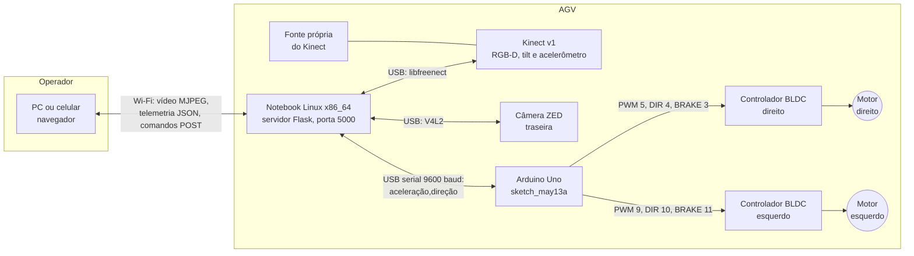

### Inicialização do sistema

O que o `launch_production.py` faz do comando até o painel abrir:

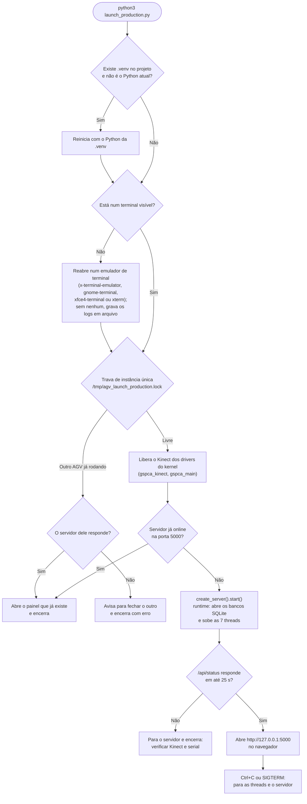

---

## 11. Funcionamento da Realidade Aumentada

### 11.1 Técnica utilizada

| Aspecto | Neste projeto |
|---|---|
| **Tipo de exibição** | RA por vídeo (*video see-through*, Milgram e Kishino, 1994): o mundo é capturado pela câmera do AGV e as informações virtuais são compostas sobre o vídeo, numa tela comum, sem óculos |
| **Abordagem de rastreamento** | *Markerless*, baseada em **sensor de profundidade RGB-D**: não há marcador, QR Code nem detecção de plano por ARCore/ARKit; a geometria da cena vem do mapa de profundidade do Kinect v1 |
| **Reconhecimento** | **Reconhecimento facial** (face_recognition/dlib, HOG) para ancorar a identificação da pessoa sobre o vídeo da ZED |
| **Quem faz o processo** | libfreenect (captura RGB + profundidade), NumPy (distâncias), OpenCV (composição sobre o quadro), navegador (HUD em HTML/CSS sobre o vídeo) |

O projeto distingue dois tipos de elemento virtual (Azuma, 1997):

- **Fixo na tela (*screen-fixed*):** acompanha a interface, não a cena. Exemplo: o HUD com números de distância. **Já implementado.**
- **Registrado (*world-fixed*):** fica ancorado a um ponto da cena e se move com ela. Exemplo: a caixa com o nome sobre o rosto na ZED (**já implementado**) e o contorno/distância sobre o obstáculo no vídeo do Kinect (**planejado**, foco da pesquisa).

### 11.2 Fluxo técnico atual

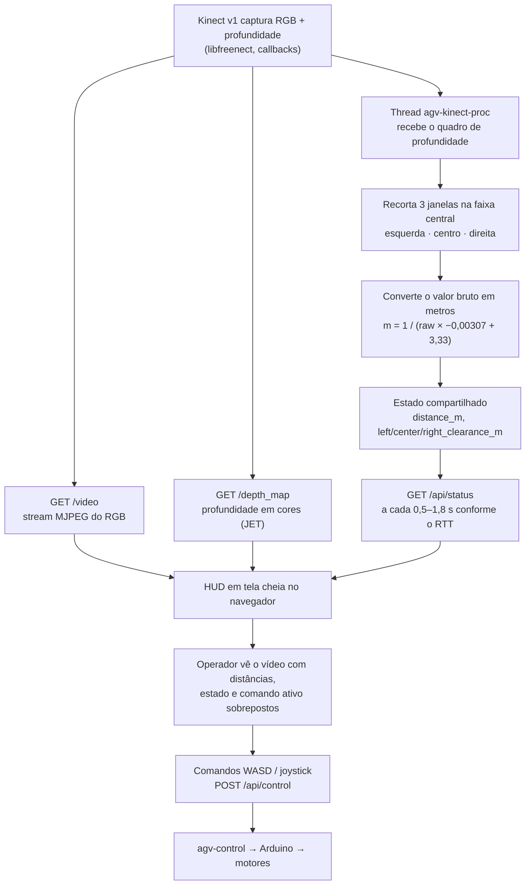

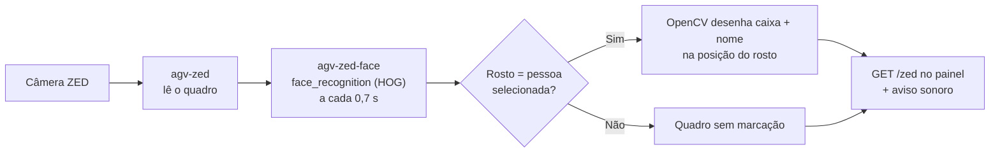

### 11.3 Como a profundidade vira distância


1. O Kinect entrega um quadro de profundidade 640×480 em 11 bits.
2. O servidor considera só a faixa entre 35% e 65% da altura e recorta **três janelas**: esquerda (10–30% da largura), centro (40–60%) e direita (70–90%).
3. Em cada janela descarta leituras inválidas e pega o **ponto mais próximo**. No formato bruto de 11 bits, que é o menor valor, o servidor o converte em metros pela fórmula da comunidade OpenKinect. Só aceita valores entre 0,15 m e 10 m.
4. A **distância frontal** é a da janela central. Se ela não existir, usa a menor das três.
5. Esses valores vão para a telemetria, para o HUD e para as regras do modo autônomo.

### 11.4 Elementos virtuais

| Elemento | Tipo | Onde aparece | Status |
|---|---|---|---|
| Chips de estado (modo, Kinect, serial) | Fixo na tela | Topo do HUD | ✅ |
| Distâncias Dist/Esq/Cen/Dir, comando ativo e FPS | Fixo na tela | Canto inferior esquerdo do HUD | ✅ |
| Miniatura do mapa de profundidade (PiP) | Fixo na tela | Canto superior direito do HUD | ✅ |
| Joystick virtual (celular) | Fixo na tela | Sobre o vídeo, dentro do HUD | ✅ |
| Selo do modo (MANUAL, AUTÔNOMO, IA) | Fixo na tela | Canto do vídeo principal do painel | ✅ |
| Caixa + nome da pessoa reconhecida | **Registrado** | Sobre o rosto, no vídeo da ZED | ✅ |
| Contorno do obstáculo | **Registrado** | Sobre o obstáculo, no vídeo RGB | ⬜ |
| Distância ancorada ao obstáculo | **Registrado** | Junto ao obstáculo | ⬜ |
| Zona de segurança no piso | **Registrado** | À frente do AGV, no piso do vídeo | ⬜ |

---

## 12. Estrutura do Projeto

```text
AGV/
├── arduino/
│   └── sketch_may13a/
│       └── sketch_may13a.ino      # firmware do Arduino Uno (motores)
├── pc_agv/                        # software do notebook do AGV
│   ├── iniciar_sistema.py         # ponto de entrada: cria e para o servidor
│   ├── config.py                  # logging e variáveis AGV_*
│   ├── estado.py                  # estado compartilhado entre threads + locks
│   ├── util.py                    # clamp() e now()
│   ├── runtime.py                 # sobe e encerra as threads
│   ├── controle.py                # modos manual, autônomo e IA; watchdog
│   ├── telemetria.py              # JSON de /api/status
│   ├── sqlite_util.py             # abertura dos bancos SQLite e preferências
│   ├── aprendizado/               # auto-aprendizado
│   │   ├── entrada.py             # miniatura da profundidade e as 48 características
│   │   ├── rede.py                # rede neural em NumPy (treino com Adam)
│   │   ├── recompensa.py          # recompensa das ações da IA (fase 2)
│   │   ├── treino.py              # conjunto de treino, validação e métricas
│   │   ├── politica.py            # camada de segurança do modo IA
│   │   ├── banco.py               # SQLite: exemplos, modelos, preferências
│   │   └── servico.py             # gravação, treino automático e decisão no modo IA
│   ├── mapeamento/                # auto-mapeamento
│   │   ├── varredura.py           # profundidade → varredura 2D ("laser")
│   │   ├── geometria.py           # poses 2D e ICP
│   │   ├── odometria.py           # odometria visual por quadros-chave
│   │   ├── grade.py               # mapa de ocupação em log-odds
│   │   ├── banco.py               # SQLite: mapas salvos
│   │   └── servico.py             # thread do mapeamento e comandos da API
│   ├── hardware/
│   │   ├── kinect.py              # captura RGB-D, tilt e liberação do USB
│   │   ├── zed.py                 # captura da câmera ZED
│   │   └── arduino.py             # serial e protocolo aceleração,direção
│   ├── visao/
│   │   ├── profundidade.py        # distâncias e mapa colorido (funções puras)
│   │   └── rostos.py              # banco de rostos e reconhecimento
│   └── web/
│       ├── rotas.py               # aplicação Flask e API REST
│       ├── mjpeg.py               # streams MJPEG
│       └── static/                # painel.html, painel.css, painel.js e js/ (um módulo por assunto)
├── tests/                         # 225 testes, todos sem hardware (seção 22.1)
│   ├── apoio.py                   # serial falsa, parada controlada dos loops, isolamento do estado e dos bancos
│   ├── simulador_kinect.py        # quadros de profundidade simulados numa sala (testes do mapa)
│   └── test_*.py                  # controle, API, serial, rostos, captura, aprendizado, mapa...
├── .github/workflows/ci.yml       # CI: testes, lint, imagem Docker e executável
├── docs/
│   ├── diagrams/                  # arquitetura e janelas de profundidade (SVG)
│   ├── documents/                 # síntese do artigo científico
│   └── images/                    # capturas de tela do painel e do HUD
├── logs/                          # rostos, aprendizado.db e mapas.db gerados em runtime (fora do Git)
├── launch_production.py           # ponto de entrada: sobe o servidor e abre o navegador
├── launch_production.spec         # receita do PyInstaller (executável único)
├── requirements.txt               # dependências Python (faixas testadas)
├── ruff.toml                      # regras do lint
├── scripts/instalar_freenect_python.sh  # compila o driver Python do Kinect
├── Dockerfile                     # imagem python:3.11-slim-bookworm + libfreenect
├── docker-compose.yml             # execução no notebook do AGV (Linux, com hardware)
├── docker-compose.windows.yml     # só o painel, sem hardware (Docker Desktop)
├── CHANGELOG.md
├── LICENSE
└── README.md
```

| Pasta / arquivo | Finalidade |
|---|---|
| `pc_agv/` | Todo o software que roda no notebook do AGV, dividido por responsabilidade (seção 13) |
| `pc_agv/hardware/` | Acesso ao Kinect, à ZED e ao Arduino |
| `pc_agv/visao/` | Processamento de imagem: profundidade e rostos |
| `pc_agv/aprendizado/` | Auto-aprendizado: exemplos, rede neural, recompensa, segurança e banco |
| `pc_agv/mapeamento/` | Auto-mapeamento: varredura, ICP, odometria visual, mapa de ocupação e banco |
| `pc_agv/web/` | Servidor HTTP, streams e arquivos do painel |
| `arduino/` | Firmware que recebe os comandos pela serial e aciona os controladores BLDC |
| `tests/` | Testes automatizados (`unittest`) que rodam sem o hardware conectado |
| `docs/diagrams/` | Diagramas técnicos do projeto atual |
| `docs/images/` | Capturas de tela da interface |
| `docs/documents/` | Material da pesquisa (síntese do artigo) |
| `logs/` | Dados gerados em execução: `encodings.pkl`, fotos de rosto, `aprendizado.db` e `mapas.db`. Ignorado pelo Git. No executável, fica ao lado do binário; `AGV_DADOS_DIR` muda o local |

---

## 13. Principais Scripts e Componentes

| Arquivo / componente | Responsabilidade |
|---|---|
| `launch_production.py` | Garante instância única, abre um terminal visível para os logs, libera o Kinect, sobe o servidor, espera `/api/status` responder e abre o navegador |
| `pc_agv/iniciar_sistema.py` | Ponto de entrada: `AGVServerController`, `create_server`, `serve` e `main` |
| `pc_agv/config.py` | Configuração de logging e leitura de todas as variáveis `AGV_*` |
| `pc_agv/estado.py` | Estado compartilhado (`state`, `control_state`, `autopilot_state`, `settings`), cada um com seu *lock*, e o `stop_event` |
| `pc_agv/runtime.py` | `start_runtime` / `stop_runtime`: abre os bancos, sobe e encerra as sete threads |
| `pc_agv/controle.py` | `compute_autopilot_command` (regras do autônomo), `autopilot_loop` (autônomo ou IA) e `control_loop` (manual, autônomo, IA, correção ou watchdog → Arduino) |
| `pc_agv/telemetria.py` | `status_snapshot`: junta o estado de todos os módulos para `/api/status` |
| `pc_agv/hardware/kinect.py` | `capture_loop`, estabilização e tilt manual (`command_kinect_tilt`), `release_kinect_usb_claims` (descarrega `gspca_kinect` etc.) e `request_reconnect` |
| `pc_agv/hardware/zed.py` | Descoberta da ZED e `capture_loop` (OpenCV V4L2 ou FFmpeg) |
| `pc_agv/hardware/arduino.py` | Conexão serial, `speed_steering_to_payload` (−100..100 → `aceleração,direção`), `send_to_arduino` com limite de velocidade e estado do link |
| `pc_agv/visao/profundidade.py` | Funções puras: `depth_segment_distance`, `compute_depth_metrics` e `depth_to_colormap` |
| `pc_agv/visao/rostos.py` | Banco de rostos, `face_worker_loop`, `offer_frame` (marcação sobre o vídeo da ZED) e `register_face` |
| `pc_agv/web/rotas.py` | Aplicação Flask: painel e API REST; as rotas só traduzem HTTP e chamam os módulos |
| `pc_agv/web/mjpeg.py` | `mjpeg_generator`: streams RGB, profundidade e ZED com quadro de espera |
| `pc_agv/aprendizado/entrada.py` | `miniatura` (profundidade → 24×32 blocos, percentil 20) e `extrair_entradas` (48 características: distância mais próxima e fração de leitura em 3 faixas de altura × 8 colunas) |
| `pc_agv/aprendizado/rede.py` | `RedeNeural`: perceptron 48-32-16-2 com tanh, Adam e parada antecipada; salva os pesos sem pickle |
| `pc_agv/aprendizado/recompensa.py` | `recompensas`, `retornos` (desconto 0,8) e `pesos_por_retorno` (regressão ponderada pela recompensa) |
| `pc_agv/aprendizado/treino.py` | `montar_conjunto`, validação nos 20% mais recentes e `avaliar` (acerto de direção e de movimento contra o operador) |
| `pc_agv/aprendizado/politica.py` | `aplicar_seguranca`: limites do modo IA |
| `pc_agv/aprendizado/servico.py` | `coletar`, `iniciar_treino`, `decidir`, `registrar_parada` e a thread `aprendizado_loop` |
| `pc_agv/mapeamento/varredura.py` | `varredura`: faixa da profundidade → 160 pontos no plano, com os intrínsecos do Kinect v1 |
| `pc_agv/mapeamento/geometria.py` | `Pose`, `compor`, `icp` (ponto a ponto + ponto a reta) e `icp_robusto` (várias partidas e restrição de tração diferencial) |
| `pc_agv/mapeamento/odometria.py` | `Odometria`: quadros-chave, recusa de saltos e previsão por velocidade constante |
| `pc_agv/mapeamento/grade.py` | `Grade`: mapa de ocupação em log-odds, recorte, imagem e persistência |
| `pc_agv/mapeamento/servico.py` | `passo`, `ligar`/`pausar`/`novo`, `salvar`/`abrir`/`apagar`, `imagem_png` e a thread `mapeamento_loop` |
| `pc_agv/sqlite_util.py` | Abertura dos bancos (integridade, WAL) e preferências na tabela `meta` |
| `pc_agv/web/static/` | `painel.html`, `painel.css`, `painel.js` e `js/`: controle, vídeos, HUD, telemetria, gráficos, rostos, ajustes, navegação, aprendizado e mapa |
| `arduino/.../sketch_may13a.ino` | Firmware: rampa de aceleração, filtro anti-tremor, anti-reversão, timeout de 500 ms, modo degradado e comandos `STOP`, `RESET`, `STATUS`, `PING` |

### Dependências entre módulos

Gerado a partir dos `import` reais do código. As setas apontam para o módulo usado, e não há ciclos: cada camada só depende das camadas abaixo.

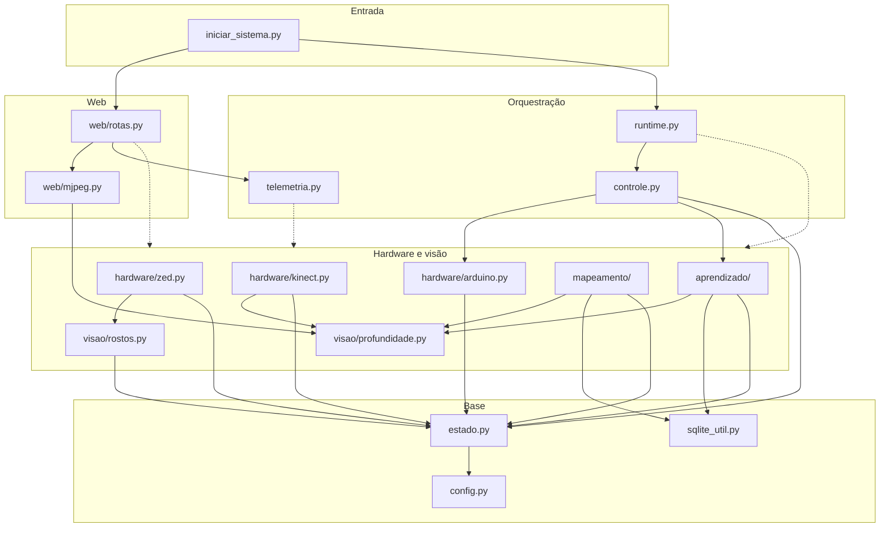

As setas tracejadas indicam uso de módulos da camada "Hardware e visão":

- `web/rotas.py` usa `kinect`, `arduino`, `rostos`, `aprendizado` e `mapeamento`;
- `runtime.py` usa `kinect`, `zed`, `arduino`, `rostos`, `aprendizado` e `mapeamento`;
- `telemetria.py` usa `kinect`, `arduino`, `rostos`, `aprendizado` e `mapeamento`.

Quase todos os módulos também importam `config.py` (variáveis `AGV_*`) e `util.py`; essas setas foram omitidas para o diagrama ficar legível.

### API HTTP

| Método | Rota | Uso |
|---|---|---|
| GET | `/` | Painel web |
| GET | `/video` · `/depth_map` · `/zed` | Streams MJPEG (RGB, profundidade, ZED) |
| GET | `/api/status` | Telemetria completa em JSON |
| GET | `/api/access_link` | Endereço do painel na rede local |
| POST | `/api/control` | Modo (`manual`/`auto`/`ia`), velocidade e direção; `ia` sem modelo responde 409; no modo IA o comando vale como correção |
| POST | `/api/stop` | Parada total |
| GET/POST | `/api/settings` | Limite de velocidade (`speed_limit_pct`) |
| POST | `/api/kinect/reconnect` · `/api/kinect/tilt` | Reconectar Kinect e ajustar o tilt |
| GET/POST | `/api/kinect/stabilization` | Ligar/desligar a estabilização |
| GET | `/api/face/status` | Estado do reconhecimento facial |
| POST | `/api/face/register_face` · `/api/face/select` | Cadastrar rosto (foto + nome) e escolher a pessoa |
| GET | `/api/ia/status` · `/api/ia/modelos` | Estado do aprendizado; modelos salvos com a curva de treino |
| POST | `/api/ia/config` | Gravar exemplos, explorar e velocidade máxima da IA |
| POST | `/api/ia/treinar` | Treina em segundo plano (202); 409 sem exemplos suficientes ou com treino em andamento |
| POST | `/api/ia/modelos/<id>/ativar` · `/api/ia/apagar` | Volta a um modelo; apaga exemplos ou tudo (exige `"confirmar": true`) |
| GET | `/api/mapa/status` · `/api/mapa/lista` · `/api/mapa/imagem.png` | Mapa ao vivo (pose, trajeto, varredura, recorte), mapas salvos e imagem do mapa |
| POST | `/api/mapa/ligar` · `pausar` · `novo` · `salvar` · `config` | Controla o mapeamento, salva com nome e ajusta o avanço do Kinect |
| POST | `/api/mapa/<id>/abrir` · `/api/mapa/<id>/apagar` | Abre um mapa salvo para consulta ou o apaga |

Exemplo de comando manual:

```bash
curl -X POST http://127.0.0.1:5000/api/control \
  -H 'Content-Type: application/json' \
  -d '{"mode":"manual","speed":55,"steering":0,"source":"curl"}'
```

### Protocolo serial (PC → Arduino)

Formato `aceleração,direção\n`, com aceleração em −255..255 e direção em −254..254:

| Ação no painel | Linha enviada |
|---|---|
| W (frente) | `255,0` |
| A com o AGV parado (gira à esquerda) | `140,-124` |
| W + D (frente virando à direita) | `255,124` |
| W com limite de velocidade em 50% | `127,0` |
| Parado | `0,0` |

### Ciclo do firmware do Arduino

O `sketch_may13a.ino` roda a cerca de 100 Hz e é a última barreira de segurança antes dos motores:

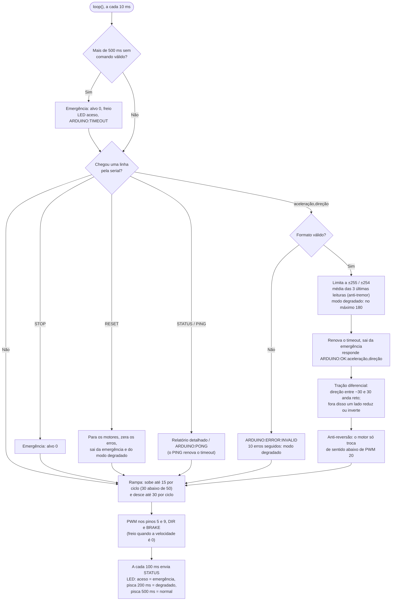

### Bancos de dados (SQLite)

Dois arquivos em `logs/`: `aprendizado.db` (tabelas `sessoes`, `amostras`, `modelos` e `meta`) e `mapas.db` (tabelas `mapas` e `meta`). A tabela `meta` guarda as preferências de cada recurso.

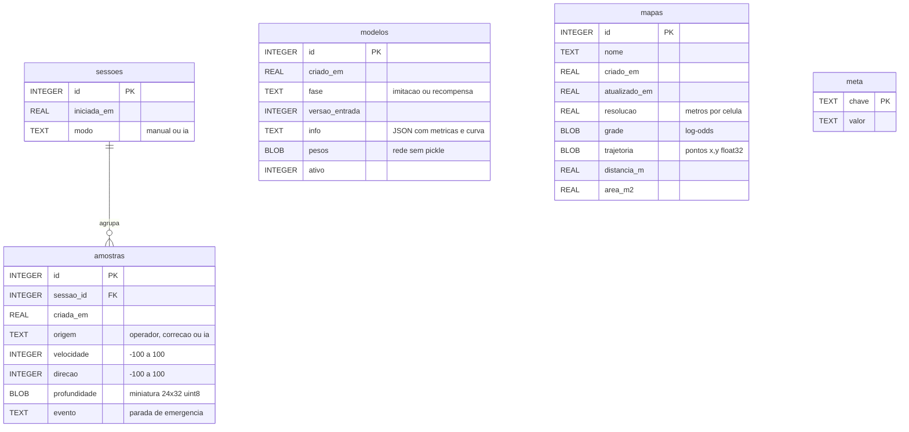

---

## 14. Dependências

**Python** ([`requirements.txt`](requirements.txt), instaladas via PyPI):

```text
flask>=3.0,<4
opencv-python-headless>=4.8,<5
numpy>=1.24,<3
pyserial>=3.5,<4
face-recognition>=1.3.0,<2
setuptools<81        # face_recognition_models usa pkg_resources (removido no setuptools 81)
```

**Sistema (Linux):**

```text
libfreenect-dev libfreenect-bin libusb-1.0-0-dev  # biblioteca C do Kinect v1 (OpenKinect)
libusb-1.0-0 udev                                  # acesso USB
build-essential cmake                              # compilar o dlib do face-recognition
ffmpeg                                             # opcional, captura alternativa da ZED
```

O auto-aprendizado e o auto-mapeamento **não acrescentam dependências**: usam NumPy, OpenCV e o `sqlite3` da biblioteca padrão.

| Dependência essencial | Onde obter |
|---|---|
| libfreenect (C) | Repositórios Debian/Ubuntu (`apt install libfreenect-dev`) |
| Driver Python `freenect` | **Não existe pacote `python3-freenect`** no Ubuntu/Debian: é compilado de [OpenKinect/libfreenect](https://github.com/OpenKinect/libfreenect) pelo `scripts/instalar_freenect_python.sh` |
| face_recognition / dlib | [PyPI](https://pypi.org/project/face-recognition/) · [ageitgey/face_recognition](https://github.com/ageitgey/face_recognition) |
| Arduino IDE | [arduino.cc/en/software](https://www.arduino.cc/en/software) |
| Docker | [docs.docker.com/engine/install](https://docs.docker.com/engine/install/) |

---

## 15. Configuração do Ambiente

Escolha o cenário. **A** é o caminho recomendado no AGV, **B** é sem Docker e **C** é só para ver o painel em outro computador.

### A) Notebook do AGV (Linux) com Docker — recomendado

1. Instale o Git e o Docker Engine com o plugin Compose:

   ```bash
   sudo apt update && sudo apt install -y git
   # Docker: siga https://docs.docker.com/engine/install/ubuntu/
   ```

2. Clone o repositório:

   ```bash
   git clone https://github.com/Kauan-V-Marques/AGV.git
   cd AGV
   ```

3. Grave o firmware no Arduino (uma vez):
   1. Instale a Arduino IDE.
   2. Abra `arduino/sketch_may13a/sketch_may13a.ino`.
   3. Em **Ferramentas → Placa**, escolha **Arduino Uno** e selecione a porta.
   4. Clique em **Carregar**. O LED 13 pisca 3 vezes ao iniciar.
4. Conecte o Kinect (com a fonte própria ligada) e o Arduino por USB.
5. Confira a porta do Arduino com `ls /dev/ttyACM*`. Se não for `/dev/ttyACM0`, edite `devices` em `docker-compose.yml`.

### B) Notebook do AGV (Linux) sem Docker

```bash
sudo apt update
sudo apt install -y git python3 python3-pip python3-dev libfreenect-dev libfreenect-bin libusb-1.0-0-dev build-essential cmake curl ffmpeg
git clone https://github.com/Kauan-V-Marques/AGV.git
cd AGV
pip3 install -r requirements.txt --break-system-packages   # compila o dlib: leva alguns minutos
PIP_ARGS=--break-system-packages bash scripts/instalar_freenect_python.sh   # driver Python do Kinect
sudo usermod -aG dialout $USER                              # acesso à serial (refaça o login)
```

> Se preferir um ambiente virtual: `python3 -m venv .venv`, `.venv/bin/pip install -r requirements.txt` e `PYTHON=.venv/bin/python bash scripts/instalar_freenect_python.sh`. O launcher usa a `.venv` automaticamente se ela existir.

### C) Windows ou Mac — só visualizar o painel (sem hardware)

1. Instale o [Docker Desktop](https://www.docker.com/products/docker-desktop/) (no Windows, com backend WSL2).
2. Clone o repositório e use o compose sem hardware (passo 16.C).

### Configurações opcionais (variáveis de ambiente)

| Variável | Padrão | Uso |
|---|---|---|
| `AGV_HOST` / `AGV_PORT` | `0.0.0.0` / `5000` | Interface e porta HTTP |
| `AGV_ARDUINO_PORT` | automática | Porta serial fixa (ex.: `/dev/ttyACM1`) |
| `AGV_ARDUINO_BAUD` | `9600` | Baud rate do Arduino |
| `AGV_ARDUINO_ENABLED` | `1` | `0` desliga a serial |
| `AGV_VIDEO_FPS` / `AGV_DEPTH_FPS` | `6` / `4` | FPS dos streams |
| `AGV_WATCHDOG_TIMEOUT_S` | `2.0` | Tempo sem comando manual até parar (`0` desativa) |
| `AGV_SPEED_LIMIT_PCT` | `100` | Limite inicial de velocidade |
| `AGV_KINECT_STABILIZATION` | `1` | Estabilização do tilt |
| `AGV_ZED_DEVICE` | `/dev/video0` | Dispositivo da câmera ZED |
| `AGV_MAX_UPLOAD_MB` | `10` | Tamanho máximo da foto no cadastro de rosto (acima disso: erro 413) |
| `AGV_FACE_DETECT_MODEL` | `hog` | `cnn` é mais preciso e muito mais lento |
| `AGV_DADOS_DIR` | `logs/` do projeto (no executável: ao lado do binário) | Pasta dos rostos, do aprendizado e dos mapas |
| `AGV_IA_AMOSTRAS_HZ` | `5` | Exemplos gravados por segundo |
| `AGV_IA_MIN_AMOSTRAS` | `150` | Exemplos do operador necessários para o primeiro treino |
| `AGV_IA_TREINO_AUTOMATICO` | `400` | Treina sozinho a cada N exemplos novos, com o AGV parado (`0` = só pelo botão) |
| `AGV_IA_MAX_AMOSTRAS` | `150000` | Acima disso os exemplos mais antigos são apagados |
| `AGV_IA_CORRECAO_JANELA_S` | `1.0` | Por quanto tempo um comando do operador vale como correção no modo IA |
| `AGV_KINECT_AVANCO_M` | `0` | Distância do eixo das rodas até o Kinect (o painel do Mapa também ajusta, em cm) |
| `AGV_KINECT_DEPTH_FX` / `AGV_KINECT_DEPTH_CX` | `594.21` / `339.31` | Parâmetros intrínsecos da câmera de profundidade (referência do Kinect v1) |
| `AGV_MAPA_HZ` / `AGV_MAPA_RESOLUCAO_M` / `AGV_MAPA_TAMANHO_M` | `4` / `0.05` / `30` | Quadros por segundo do mapeamento, tamanho da célula e do mapa |

As demais variáveis são ajustes finos (tilt do Kinect, resolução e FPS da ZED, limiares do reconhecimento facial, ciclos de controle, PWM mínimo dos motores) e estão em [`pc_agv/config.py`](pc_agv/config.py), com o valor padrão ao lado; as da serial ficam em [`pc_agv/hardware/arduino.py`](pc_agv/hardware/arduino.py).

---

## 16. Como Executar

```bash
git clone https://github.com/Kauan-V-Marques/AGV.git
cd AGV
```

### A) No AGV, com Docker

```bash
docker compose up --build        # a 1ª build compila o dlib e demora
```

- Em segundo plano: `docker compose up -d --build`. Logs: `docker compose logs -f`. Parar: `docker compose down`.
- Acesse `http://localhost:5000` no próprio AGV ou `http://IP_DO_AGV:5000` de outro dispositivo da rede. O endereço aparece no topo do painel.

### B) No AGV, sem Docker

```bash
python3 launch_production.py
```

O launcher libera o Kinect, sobe o servidor, espera a API responder (até 25 s), abre `http://127.0.0.1:5000` no navegador e mantém os logs no terminal. **Ctrl+C** encerra.

### C) Windows/Mac, só o painel

```bash
docker compose -f docker-compose.windows.yml up --build
```

Acesse `http://localhost:5000`. Os vídeos mostram "Aguardando Kinect/ZED" e a serial fica desativada: é o comportamento esperado sem hardware.

### D) Desenvolvimento e testes (qualquer sistema com Python 3.11)

```bash
pip install -r requirements.txt ruff coverage
python -m unittest discover -s tests -v    # testes automatizados
ruff check .                               # lint
coverage run --source=pc_agv -m unittest discover -s tests && coverage report   # cobertura
python -m pc_agv.iniciar_sistema           # só o servidor, sem o launcher (que é exclusivo de Linux)
```

> No Windows, o `pip` compila o dlib: é preciso ter o [CMake](https://cmake.org/download/) e o *Visual Studio Build Tools* (C++) instalados.

### E) Gerar o executável único (Linux)

```bash
pip3 install pyinstaller --break-system-packages
pyinstaller launch_production.spec
./dist/launch_production
```

Os dados (rostos, aprendizado e mapas) ficam em `dist/logs/`, ao lado do executável.

---

## 17. Como Utilizar a Aplicação

O painel tem um **menu lateral** (no celular, no botão ☰ do topo) com as seções Painel, Câmeras, Telemetria, Aprendizado, Mapa e Configurações. A barra do topo mostra o estado do AGV, do Kinect, da ZED, do Arduino e o tempo de resposta da rede, e tem sempre o botão **PARADA DE EMERGÊNCIA**.

### 17.1 Dirigir

1. **Ligue o AGV** e inicie o sistema (seção 16). O navegador abre o painel.
2. **Confira os indicadores do topo:** Kinect, ZED e Arduino em verde. Se o Kinect estiver offline, use **Reconectar Kinect** em *Configurações*.
3. **Para dirigir de outro dispositivo:** em *Configurações → Abrir em outro dispositivo*, clique em **Copiar** e abra o endereço no PC ou celular do operador, na mesma rede Wi-Fi.
4. **Escolha o modo** no quadro *Controle do AGV*: **Manual** (padrão), **Autônomo** ou **IA** (liberado depois do primeiro treino, seção 17.2).
5. **No modo manual:**
   - no PC: **W/↑** frente, **S/↓** ré, **A/←/E** esquerda, **D/→** direita;
   - no celular: arraste o **joystick virtual** e solte para parar.
6. **Câmeras:** clique na miniatura para trocá-la com o vídeo principal; **Foto** salva um PNG; **HUD** abre o vídeo em tela cheia com distâncias, comando, FPS e a miniatura da profundidade (sai com **ESC** ou **Sair**).
7. **Proximidade:** os setores ao lado do vídeo mudam de cor conforme a distância (verde, amarelo, laranja, vermelho) e o gráfico mostra os últimos 60 s.
8. **Ajustes** (*Configurações*): tilt do Kinect (**Subir**, **Centralizar**, **Descer**), estabilização, velocidade máxima, tema e bipe.
9. **Em qualquer emergência**, clique em **PARADA DE EMERGÊNCIA** (também no HUD).
10. *(Opcional)* **Procurar uma pessoa na ZED:** em *Configurações → Cadastrar rosto*, informe o nome, escolha ou arraste uma foto e clique em **Registrar rosto**; depois selecione a pessoa em *Detecção facial*. Quando ela aparecer na ZED, uma caixa verde com o nome é desenhada sobre o rosto e o painel emite um bipe.

### 17.2 Ensinar a IA (auto-aprendizado)

1. Em *Aprendizado*, deixe **Aprender com o operador** ligado e **dirija no modo Manual** como você gostaria que o AGV dirigisse: desviando, parando antes de obstáculos, contornando. Cada manobra vira um exemplo (5 por segundo).
2. Com **150 exemplos** do operador, clique em **Treinar agora** (leva segundos). O AGV também treina sozinho a cada 400 exemplos novos, quando fica parado.
3. Confira o **acerto de direção** e a **curva de treino**. Ajuste a **velocidade máxima da IA** (padrão 50%).
4. Escolha **IA** no controle. Quando a IA errar, **segure a tecla certa** (ou o joystick): a correção vale na hora e vira exemplo com peso dobrado. Soltou, a IA volta a dirigir.
5. **Treine de novo:** as ações da IA entram no treino pesadas pela recompensa, e o modelo passa da fase *imitação* para *recompensa*.
6. Se um treino piorar o comportamento, volte a um modelo anterior em **Modelos salvos → Usar**.

### 17.3 Mapear o ambiente (auto-mapeamento)

1. Em *Mapa → Calibração*, informe a distância **do eixo das rodas até o Kinect**, em cm (medida com trena, uma vez só).
2. Clique em **Mapear** e dirija o AGV **devagar**, girando aos poucos. As paredes vistas pelo Kinect aparecem no mapa, com o trajeto e o AGV.
3. O indicador **Odometria** mostra se as leituras estão casando (`ok`), se a vista está tapada (`prevendo`) e quantas falharam.
4. Dê um nome e clique em **Salvar**. Salvar de novo atualiza o mesmo mapa.
5. **Novo mapa** recomeça do zero. Em *Mapas salvos*, **Abrir** mostra um mapa antigo para consulta (para mapear de novo, comece um mapa novo).

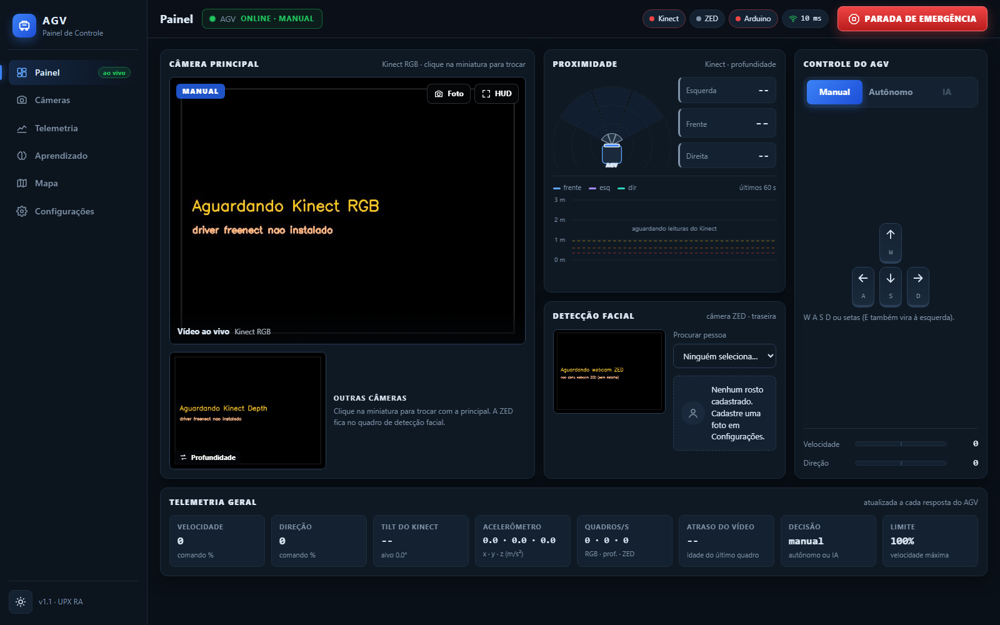

---

## 18. Fluxo de Funcionamento

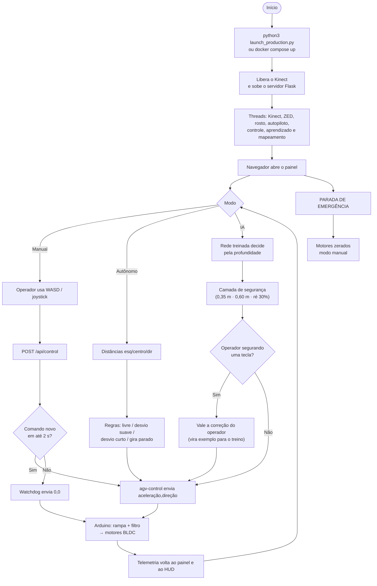

### Modos de controle

O `agv-control` decide a cada 0,12 s qual comando vale. O servidor sempre começa no modo Manual:

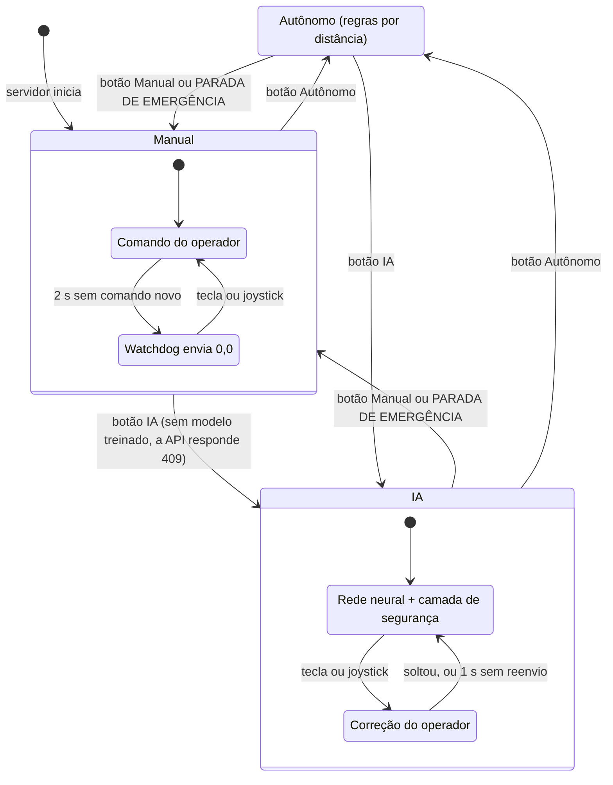

A parada de emergência no modo IA também marca a última ação da IA com penalidade para o próximo treino.

### Regras do modo autônomo

`compute_autopilot_command` em `controle.py`, chamado a cada 0,18 s. Velocidade e direção vão de −100 a 100 (% do PWM):

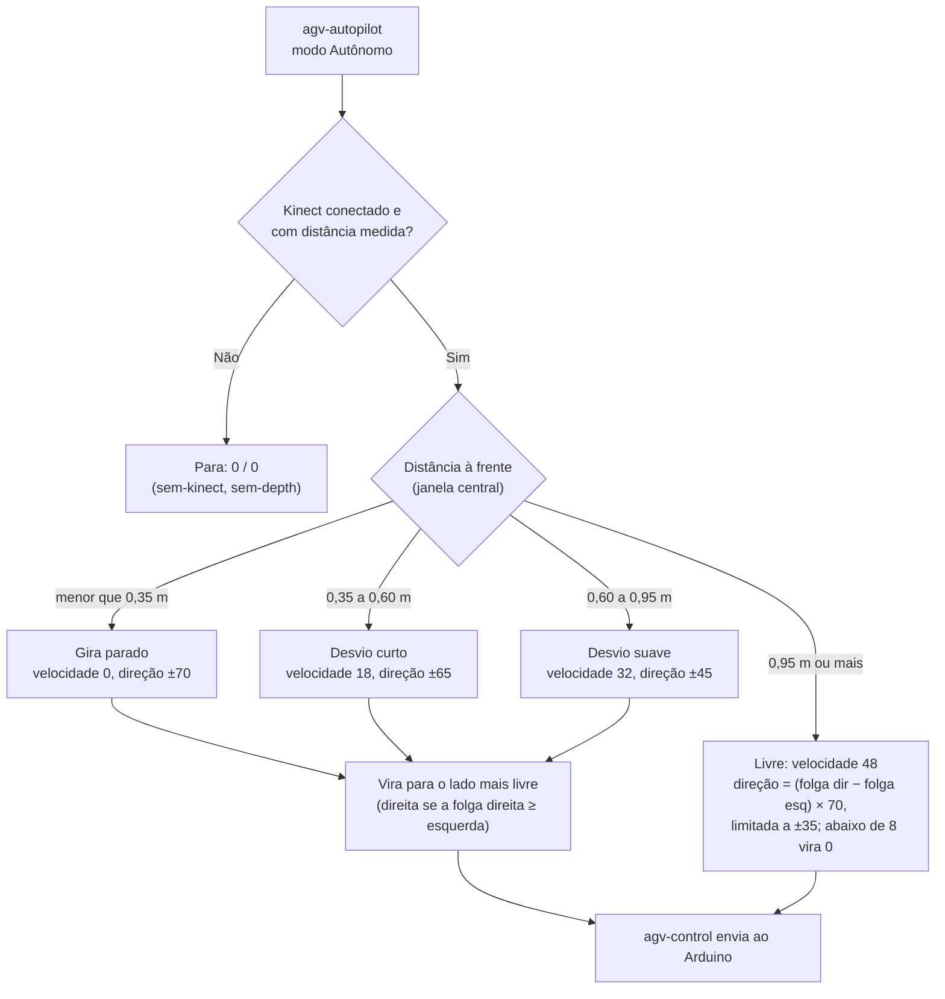

### Sequência de um comando com o HUD aberto

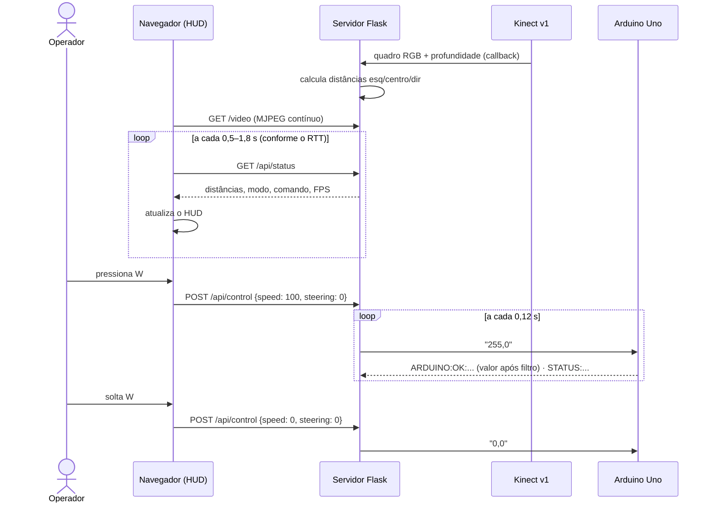

### Perda de conexão: camadas de segurança

Se o Wi-Fi cair com uma tecla pressionada, quem para o AGV é o servidor; se o próprio notebook travar ou o cabo USB soltar, é o Arduino:

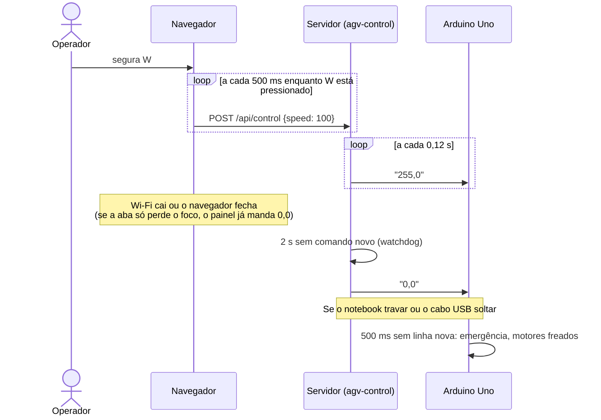

### Ciclo do auto-aprendizado

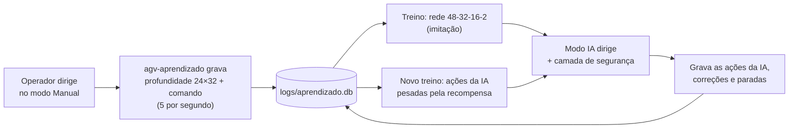

### Quando um exemplo é gravado e quando o treino dispara

`coletar` e `_manutencao` em `aprendizado/servico.py`:

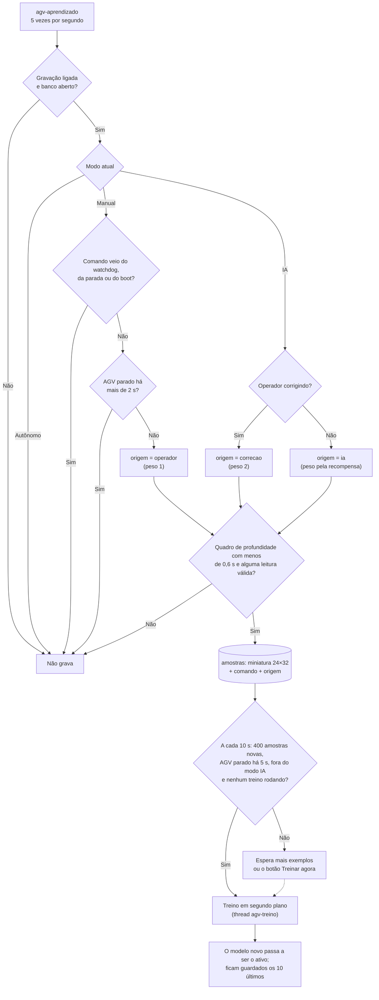

O treino exige pelo menos 150 exemplos humanos (operador + correção); acima de 150.000 amostras, as mais antigas são apagadas.

### Camada de segurança do modo IA

A rede nunca comanda os motores direto. `decidir` (em `servico.py`) e `aplicar_seguranca` (em `politica.py`):

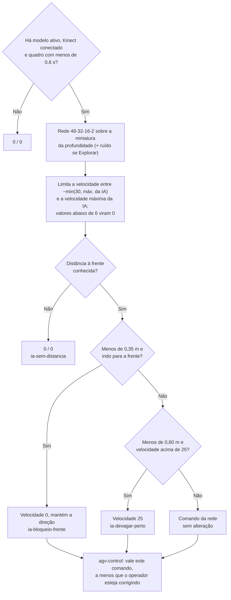

### Modo IA com correção do operador

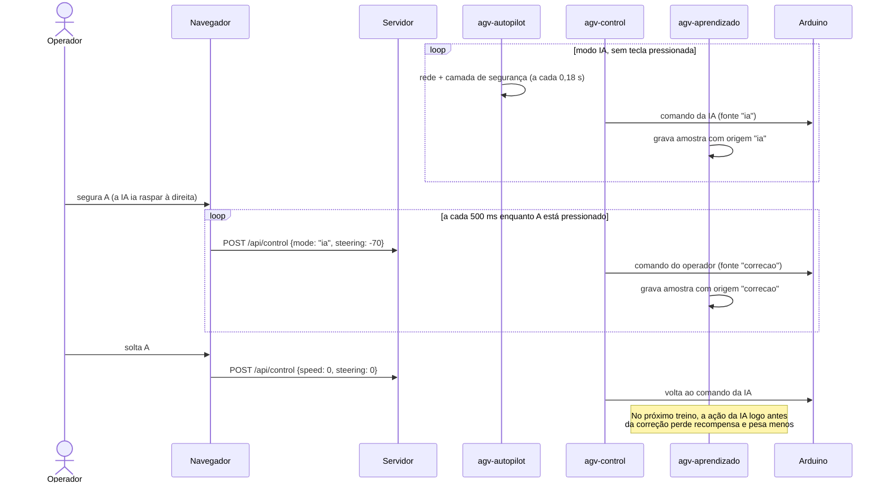

### Pipeline do auto-mapeamento

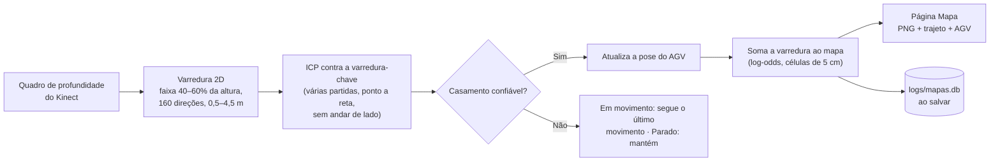

### Cadastro e busca de um rosto

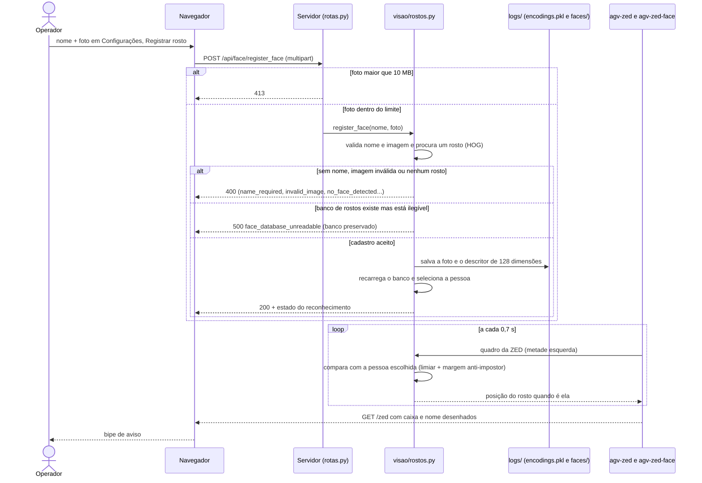

---

## 19. Caso de Uso

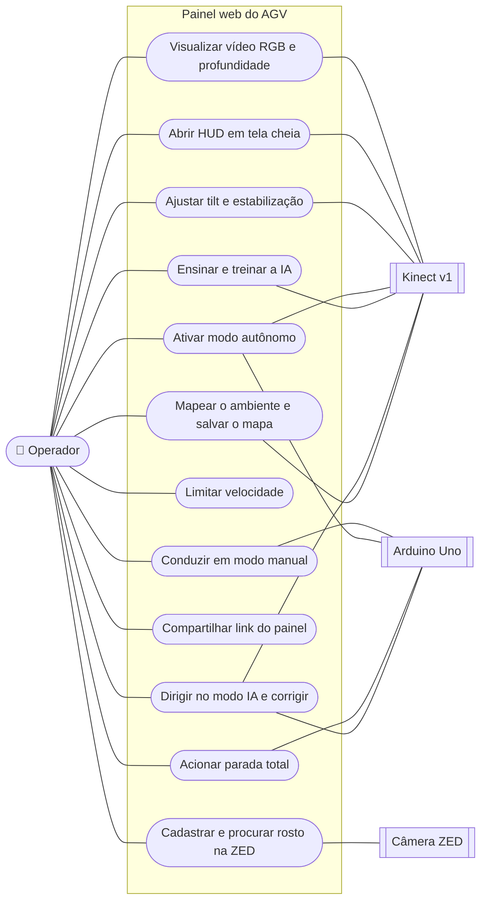

---

## 20. Fluxo de Navegação

```text
http://IP_DO_AGV:5000
 Topo (todas as seções): estado do AGV · Kinect · ZED · Arduino · tempo de resposta · PARADA DE EMERGÊNCIA
 Menu lateral (no celular: ☰)
 ├── Painel ─ câmera principal ─[HUD]──► HUD em tela cheia ──[ESC / Sair]──► Painel
 │           ├─ Foto · miniatura troca a câmera principal
 │           ├─ Proximidade: setores + gráfico de 60 s
 │           ├─ Controle: Manual · Autônomo · IA · WASD (PC) ou joystick (celular)
 │           ├─ Detecção facial: ZED + pessoa procurada
 │           └─ Telemetria geral (8 indicadores)
 ├── Câmeras ─ RGB · profundidade · ZED lado a lado
 ├── Telemetria ─ gráfico grande + todas as leituras
 ├── Aprendizado ─ indicadores · passos · ajustes · Treinar agora · curva · modelos salvos · Apagar dados
 ├── Mapa ─ indicadores · mapa ao vivo (zoom, arrasto, seguir) · Mapear/Pausar · Novo · Salvar · calibração · mapas salvos
 └── Configurações ─ câmeras e Kinect (tilt, estabilização, reconectar) · velocidade máxima · rostos · link · tema e bipe
```

---

## 21. Interface

> Capturas feitas em 16/10/2026 no Windows 10 (Microsoft Edge, modo *headless*), com o servidor rodando **sem o AGV conectado**. Por isso os vídeos mostram "Aguardando Kinect". O endereço do painel foi trocado por `127.0.0.1` para não expor a rede local. A página *Aprendizado* foi capturada com **exemplos sintéticos** (cenas de profundidade geradas pelos testes) e a página *Mapa* com um **Kinect simulado** numa sala virtual (`tests/simulador_kinect.py`): servem para mostrar a interface, não são resultados do AGV real.

### Painel principal


- **Finalidade:** central de teleoperação do AGV.
- **Elementos:** menu lateral, barra de estado com a parada de emergência, câmera principal com Foto/HUD e miniatura, proximidade (setores e gráfico de 60 s), controle (Manual/Autônomo/IA, WASD ou joystick), detecção facial na ZED e telemetria geral.
- **Ação do usuário:** escolher o modo, dirigir, trocar de câmera, acompanhar a proximidade e abrir o HUD.

### Celular

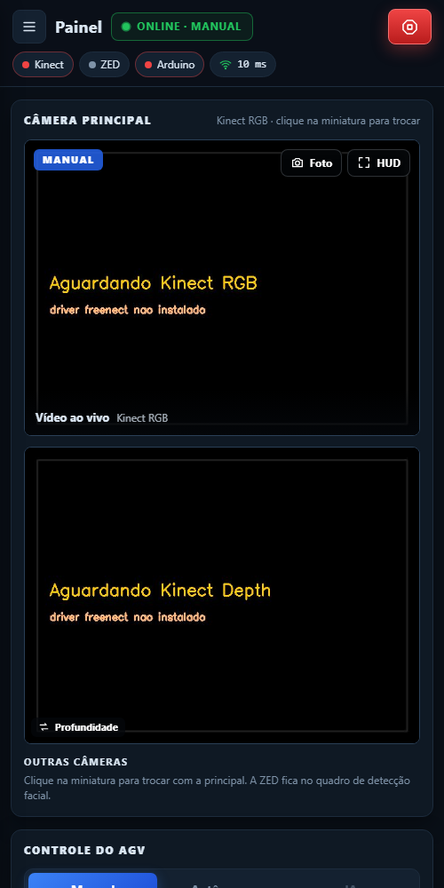

- **Finalidade:** dirigir pelo celular.
- **Elementos:** menu no botão ☰, parada de emergência sempre no topo, quadros empilhados e joystick no lugar do WASD.

### Visualizador HUD em tela cheia


- **Finalidade:** dirigir olhando só para o vídeo, com as informações do sensor sobrepostas.
- **Elementos:** vídeo RGB em tela cheia, chips de modo/Kinect/serial (topo), distâncias Dist/Esq/Cen/Dir, comando e FPS (canto inferior esquerdo), miniatura da profundidade (canto superior direito), dica de teclas e botão **Sair**. No celular, o joystick aparece sobre o vídeo.
- **Ação do usuário:** dirigir com WASD/setas ou joystick; **ESC** fecha.

### Aprendizado

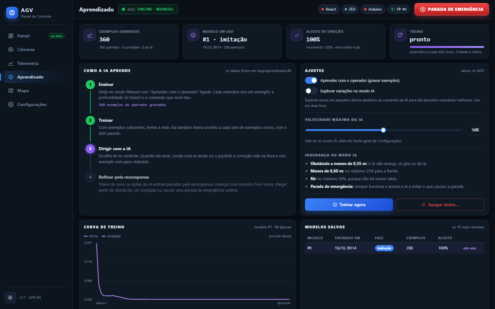

- **Finalidade:** ensinar, treinar e acompanhar a IA.
- **Elementos:** exemplos gravados, modelo em uso, acerto de direção e estado do treino; os 4 passos (ensinar, treinar, dirigir com a IA, refinar pela recompensa); ajustes salvos no AGV; curva de treino; modelos salvos; apagar dados.
- **Ação do usuário:** ligar a gravação, treinar, escolher o modelo e ajustar a velocidade da IA.

### Mapa

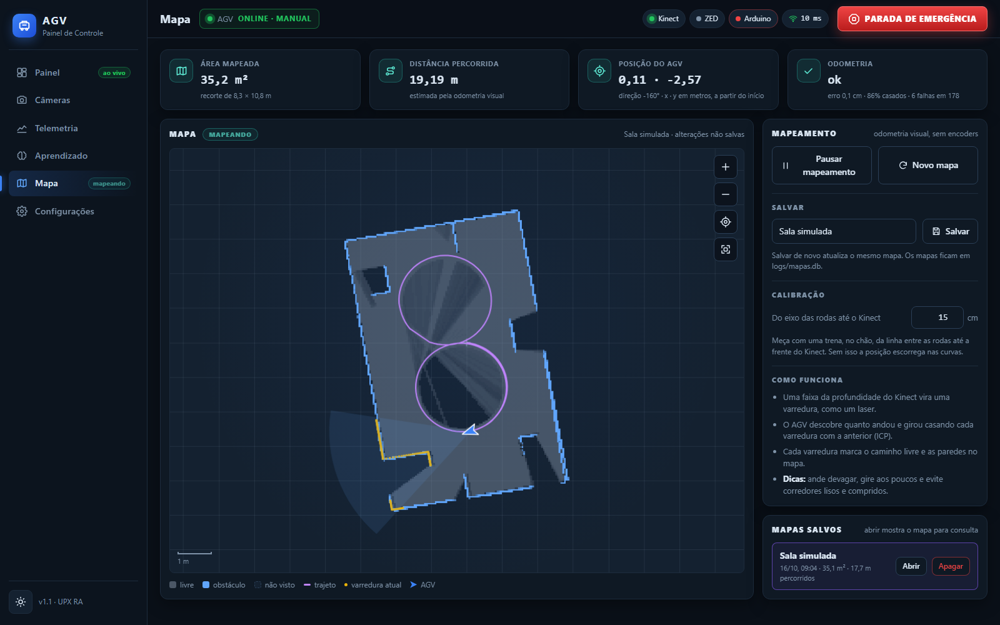

- **Finalidade:** montar e consultar o mapa do ambiente.
- **Elementos:** área mapeada, distância percorrida, posição e estado da odometria; mapa com células livres (cinza) e obstáculos (azul), trajeto (roxo), varredura atual (amarelo), o AGV e o campo de visão do Kinect; controles de zoom, seguir e enquadrar; mapear/pausar, novo, salvar, calibração e mapas salvos.
- **Ação do usuário:** calibrar, mapear dirigindo devagar, salvar e consultar mapas antigos.

### Configurações

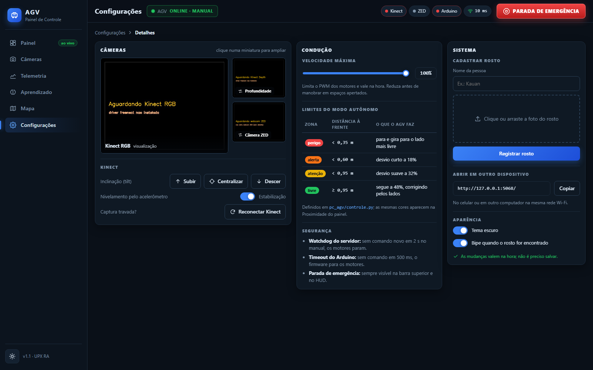

- **Finalidade:** ajustes do AGV e do painel.
- **Elementos:** câmeras com miniaturas, tilt e estabilização do Kinect, reconexão, velocidade máxima, limites do autônomo, regras de segurança, cadastro de rosto, link para outro dispositivo, tema e bipe.

---

## 22. Testes Técnicos

### 22.1 Testes automatizados

Rodam com `python -m unittest discover -s tests -v`, sem nenhum hardware: a serial, o `freenect`, a câmera ZED e o `face_recognition` são simulados. O **GitHub Actions** roda tudo a cada push ([ci.yml](.github/workflows/ci.yml)).

| Arquivo | O que verifica | Testes |
|---|---|---|
| `test_controle.py` | Regras do modo autônomo (todas as faixas de distância), **watchdog parando o AGV** sem comando novo, watchdog desligado, modo autônomo, **modo IA e correção do operador** e falha de envio ao Arduino | 20 |
| `test_aprendizado.py` | Miniatura e características da profundidade, gradiente da rede conferido numericamente, recompensa e pesos, banco SQLite (reabrir sem perder nada, banco corrompido preservado), gravação, treino automático e **ponta a ponta**: demonstrações → treino → a IA desvia para o lado certo e continua sabendo depois de reiniciar | 54 |
| `test_mapeamento.py` | Poses e ICP, varredura, mapa de ocupação, banco dos mapas e **odometria numa sala simulada com ruído do Kinect**: parado sem deriva, reta + giro, curvas com o Kinect à frente do eixo, vista tapada e salto impossível recusado | 30 |
| `test_config.py` | Pasta de dados no código-fonte, no executável e por `AGV_DADOS_DIR` | 4 |
| `test_arduino_envio.py` / `test_arduino_serial.py` | Tabela do protocolo `aceleração,direção`, limite de velocidade, ré, cabo desconectado, conexão (sem pyserial, sem porta, sem permissão/`dialout`), leitura do retorno do firmware | 18 |
| `test_rotas.py` | As 35 rotas da API: painel, streams MJPEG, status, controle (inclusive modo IA), parada total, limite de velocidade, rostos, aprendizado, mapa, entradas inválidas (400) e upload grande demais (413) | 39 |
| `test_rostos.py` | Banco de rostos (formato atual e antigo, arquivo corrompido não é apagado), regra de seleção com margem anti-impostor, fila de quadros e **cadastro com sucesso** | 19 |
| `test_captura.py` | Fluxo completo do Kinect (callback → quadro BGR → distâncias no estado), disponibilidade do Kinect, tilt, ZED com rosto marcado e leitor do FFmpeg | 18 |
| `test_depth_metrics.py` | Distância pelo ponto mais próximo, fundo distante, leituras inválidas, formato em mm e desvio no autônomo | 6 |
| `test_kinect_release.py` | Liberação dos módulos do kernel, reconexão, tilt e estabilização | 9 |
| `test_telemetria_mjpeg_runtime.py` / `test_servidor.py` | `/api/status`, quadros MJPEG, start/stop das sete threads e servidor HTTP real numa porta livre | 8 |

**Resumo:** 225 testes, todos aprovados (Windows 10 / Python 3.11.9 e Ubuntu 24.04 no CI). Cobertura do pacote `pc_agv`: **90%**.

| Módulo | Cobertura | Módulo | Cobertura |
|---|---|---|---|
| `controle.py` | 99% | `aprendizado/` | 92–100% |
| `runtime.py`, `telemetria.py`, `estado.py`, `config.py` | 100% | `mapeamento/` | 95–100% |
| `web/mjpeg.py` | 96% | `visao/profundidade.py` | 88% |
| `web/rotas.py` | 93% | `hardware/arduino.py` | 87% |
| `visao/rostos.py` | 89% | `hardware/kinect.py` | 77% |
| `sqlite_util.py` | 87% | `hardware/zed.py` | 55% |
| | | **Total** | **90%** |

O CI também **monta a imagem Docker** e **gera o executável do PyInstaller** num Ubuntu 24.04 limpo, seguindo o passo B da seção 15, e confere que os dois sobem e respondem `/api/status`. Os três trabalhos rodam em paralelo a cada push e pull request:

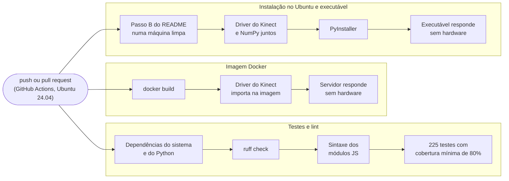

### 22.2 Testes do painel sem hardware

| Teste | Procedimento | Resultado esperado | Resultado obtido | Status |
|---|---|---|---|---|
| Servidor sobe sem hardware | `python -m pc_agv.iniciar_sistema` com `AGV_ARDUINO_ENABLED=0` | Servidor responde | `GET /`, `/api/status`, `/api/face/status` e `/api/settings` retornaram 200 | ✅ |
| Kinect ausente | Abrir o painel sem o driver `freenect` | Mensagem clara no vídeo e na telemetria | "Aguardando Kinect RGB — driver freenect nao instalado" | ✅ |
| ZED ausente | Abrir o painel sem `/dev/video*` | Mensagem no card da ZED | "Aguardando webcam ZED — nao abriu webcam ZED" | ✅ |
| Serial desativada | `AGV_ARDUINO_ENABLED=0` | Telemetria indica serial desligada | "serial desativada por ambiente" | ✅ |
| Tecla segurada além do watchdog | Painel real em navegador *headless*: W pressionado sem soltar, `active_speed` lido em 0,5/1,5/2,5/3,5 s | Velocidade mantida enquanto W estiver pressionado | 100, 100, 100, 100 (antes da correção: 100, 100, 0, 0) | ✅ |
| Navegador cai com W pressionado | Encerrar o navegador com W pressionado | Watchdog zera os motores | `active_speed` = 0 logo após o encerramento | ✅ |
| Controle certo para cada dispositivo | Abrir o painel no PC e com *user agent* de celular | PC só WASD; celular só joystick | Conforme esperado | ✅ |
| Abrir o HUD | Clicar em **HUD** | Vídeo em tela cheia com métricas e PiP | Ver captura na seção 21 | ✅ |
| Painel inteiro em navegador | Script injetado no painel real (Edge *headless*) clica em tudo e confere o servidor: seções, troca de câmera, HUD, modos, tecla segurada, parada, tema, velocidade, tilt, rostos, gráfico, aprendizado (treino, modo IA, correção com tecla, apagar) | Tudo funciona, sem erro de JavaScript | 61 de 61 verificações, 0 erros de JS (3 rodadas seguidas) | ✅ |
| Página Mapa em navegador | Mesmo método, com o Kinect simulado: calibração, mapear, mapa cresce, zoom/seguir/enquadrar, salvar, pausar, novo, abrir para consulta, apagar | Tudo funciona, sem erro de JavaScript | 26 de 26 verificações, 0 erros de JS | ✅ |

### 22.3 Odometria visual em simulação

O simulador (`tests/simulador_kinect.py`) gera quadros de profundidade como os do Kinect v1 numa sala com caixas, inclusive o ruído que cresce com o quadrado da distância (Nguyen, Izadi e Lovell, 2012). A odometria só recebe os quadros; a pose real serve para medir o erro.

| Cenário | Caminho | Erro final | Observação |
|---|---|---|---|
| Reta, giro de 90°, reta, giro de 180° e volta, com 8 quadros de vista tapada por uma caixa | 3,6 m | 6,7 cm (1,9%) e 3,3° | Durante a vista tapada a pose segue pelo último movimento |
| "8" (dois círculos de 1,2 m, duas voltas), Kinect 20 cm à frente do eixo, avanço configurado | 30,4 m | 3,8 cm (0,1%) e 0,3° | Nenhuma falha de casamento |
| O mesmo "8" sem configurar o avanço do Kinect | 30,4 m | 1,31 m (4,3%) | Por isso a calibração está na página do Mapa |
| Sem a restrição de tração diferencial | 3,6 m / 30,4 m | 1,0 m / 2,2 m | A restrição é o que impede o escorregamento |

Tempo de processamento: 16–38 ms por quadro em média (Windows 10, Python 3.11). **Isso ainda precisa ser confirmado no AGV real** (seção 22.4).

### 22.4 Testes com o AGV

| Teste | Procedimento | Resultado esperado | Resultado obtido | Status |
|---|---|---|---|---|
| Vídeo RGB e profundidade | Iniciar com o Kinect conectado | Vídeos ao vivo no painel | ⚠️ PREENCHER | ⚠️ |
| Distância medida × trena | Obstáculo a 0,5 m, 1 m e 2 m à frente | Valor do HUD próximo da trena | ⚠️ PREENCHER | ⚠️ |
| Condução manual | W/A/S/D no PC e joystick no celular | AGV obedece aos comandos | ⚠️ PREENCHER | ⚠️ |
| Parada total | Clicar em **PARADA DE EMERGÊNCIA** em movimento | AGV para imediatamente | ⚠️ PREENCHER | ⚠️ |
| Perda de conexão | Fechar a aba / desligar o Wi-Fi em movimento | AGV para em até 2 s | ⚠️ PREENCHER | ⚠️ |
| Modo autônomo | Obstáculo no caminho em modo **Autônomo** | AGV desvia ou para | ⚠️ PREENCHER | ⚠️ |
| Reconhecimento facial | Cadastrar e selecionar uma pessoa | Caixa e nome sobre o rosto na ZED | ⚠️ PREENCHER | ⚠️ |
| Modo IA | Gravar ~5 min de direção manual num percurso com obstáculos, treinar e ligar o modo IA | AGV desvia como o operador; correções obedecidas | ⚠️ PREENCHER | ⚠️ |
| Mapa de um ambiente real | Medir o avanço do Kinect, mapear um corredor/sala e comparar com a planta (trena) | Paredes retas e no lugar; erro de posição pequeno ao voltar ao início | ⚠️ PREENCHER | ⚠️ |

---

## 23. Dispositivos Testados

| Dispositivo | Sistema | Versão | Resultado |
|---|---|---|---|
| Notebook de desenvolvimento (navegador Microsoft Edge 155) | Windows 10 Pro | 22H2 (build 19045) | Painel e HUD funcionam sem hardware; launcher não roda (usa `fcntl`, exclusivo de Linux) |
| Notebook embarcado do AGV | ⚠️ PREENCHER | ⚠️ PREENCHER | ⚠️ PREENCHER |
| Celular do operador | ⚠️ PREENCHER | ⚠️ PREENCHER | ⚠️ PREENCHER |

> Só entram aqui dispositivos realmente testados.

---

## 24. Limitações Conhecidas

- **As sobreposições registradas de obstáculos ainda não existem.** O HUD atual mostra números fixos na tela; contorno, distância ancorada e zona de segurança são o próximo passo (RF33–RF35).
- **Profundidade e RGB não estão alinhados entre si.** O Kinect v1 tem as duas câmeras deslocadas, e o código ainda não registra uma sobre a outra; isso é pré-requisito para desenhar sobre o obstáculo no vídeo.
- **Faixa de medição limitada:** só a faixa central (35–65% da altura) é medida. Obstáculos baixos (paletes no chão) ou altos podem não aparecer nas distâncias.
- **Precisão do Kinect v1 cai com a distância** (Wasenmüller e Stricker, 2017), e o alcance útil vai de cerca de 0,8 m a 4 m: objetos muito próximos ficam sem leitura, e luz solar forte atrapalha a medição. Os limiares de 0,35 m e 0,60 m do modo autônomo e da IA ficam abaixo desse alcance e precisam ser conferidos no AGV real (seção 22.4); nas sobreposições, a falta de leitura vai virar um aviso de zona não medida (RF39).
- **Vídeo com baixa taxa de quadros** (6 fps RGB, 4 fps profundidade por padrão) para caber em redes fracas, o que aumenta a latência percebida.
- **O modo autônomo é reativo e simples:** regras por limiar, sem planejamento de trajetória; o mapa existe, mas ainda não é usado para navegar.
- **A IA só enxerga a profundidade à frente:** a entrada são 48 números tirados de uma miniatura 24×32; não usa a câmera RGB nem a ZED, e não sabe o que há atrás do AGV (por isso a ré da IA é limitada a 30%). Aprende só o que o operador demonstrou.
- **Poucos dados, pouca generalização:** com alguns minutos de exemplos a rede reproduz os desvios mais comuns; situações que o operador nunca mostrou podem gerar comandos ruins. A camada de segurança e a parada de emergência continuam valendo.
- **A odometria visual acumula erro:** não há fechamento de laço (*loop closure*) nem relocalização, então em percursos longos o mapa pode ficar torto; corredores lisos e compridos e espaços sem nada a menos de 4,5 m são os casos mais difíceis.
- **O mapa precisa de calibração:** sem a distância do eixo até o Kinect, a posição escorrega nas curvas (seção 22.3). Os parâmetros intrínsecos usados são os de referência do Kinect v1, não os do sensor do AGV.
- **Um mapa salvo é só para consulta:** sem encoders, o AGV não sabe onde está num mapa antigo; para continuar mapeando é preciso começar um mapa novo.
- **IA e mapa só foram validados em simulação e com dados sintéticos:** os testes com o AGV (seção 22.4) ainda estão pendentes.
- **Hardware só em Linux:** libfreenect, `/dev/tty*` e o launcher (`fcntl`). No Windows/Mac só é possível ver o painel.
- **Sem autenticação:** qualquer dispositivo da mesma rede pode abrir o painel e comandar o AGV.
- **`sudo` sem senha:** o servidor tenta descarregar `gspca_kinect` com `sudo -n`. Se o sudo pedir senha, isso falha em silêncio; rode `sudo modprobe -r gspca_kinect gspca_main` antes.
- **A imagem Docker não inclui FFmpeg:** dentro do container a ZED só abre pelo OpenCV.
- **1ª build lenta:** o `face-recognition` compila o dlib do código-fonte.
- **RTT não é registrado:** a latência só aparece como aviso na tela; a pesquisa precisa dela em log (RF37).
- **Distância pelo pixel mais próximo:** cada janela usa o ponto mais próximo; um pixel isolado com ruído pode gerar um alerta falso. Ainda não há filtro (ex.: percentil ou mediana).
- **O CI não tem hardware:** Kinect, ZED e Arduino são simulados; o funcionamento real só é validado no AGV (seção 22.4). A captura da ZED por FFmpeg é a parte menos coberta (`zed.py`, 55%).
- **Os testes funcionais do painel não rodam no CI:** o JavaScript é verificado por scripts no navegador *headless* (61 + 26 verificações, seção 22.2), executados durante o desenvolvimento; o CI só confere a sintaxe dos módulos.

---

## 25. Evidências de Funcionamento

- Capturas do painel, do HUD, do celular e das páginas Aprendizado, Mapa e Configurações: [seção 21](#21-interface).
- Validação da odometria visual em simulação: [seção 22.3](#223-odometria-visual-em-simulação).
- ⚠️ PREENCHER: foto do AGV montado (salvar em `docs/images/agv.jpg`).
- ⚠️ PREENCHER: captura do HUD com o vídeo real do Kinect e as distâncias preenchidas (salvar em `docs/images/hud-kinect-real.png`).
- ⚠️ PREENCHER: vídeo de demonstração — `[Assistir demonstração](LINK_DO_VIDEO)`.

---

## 26. Repositórios e Recursos

| Recurso | Link |
|---|---|
| Código-fonte | [github.com/Kauan-V-Marques/AGV](https://github.com/Kauan-V-Marques/AGV) |
| Síntese do artigo | [docs/documents/pesquisa-artigo.md](docs/documents/pesquisa-artigo.md) |
| Modelo de documentação da disciplina | [github.com/dr-ohata/upx-modelo](https://github.com/dr-ohata/upx-modelo) |
| Driver do Kinect v1 | [github.com/OpenKinect/libfreenect](https://github.com/OpenKinect/libfreenect) |
| Quadro de tarefas e sprints | Trello da equipe (privado; acesso por convite) |
| Vídeo de demonstração | ⚠️ PREENCHER |

---

## 27. Cronograma Técnico

Linha do tempo montada a partir das datas dos commits:

```mermaid
timeline
    title Evolução do AGV em 2026
    abril : Upload inicial e servidor web (12/04) : v1.0.2 (13/04)
    maio : v1.0.3 com Kinect, ZED, Arduino e reconhecimento facial
    julho : v1.0.4 com o firmware reorganizado e a ré
    agosto : HUD em tela cheia (PR 1) : Organização do repositório e Docker (PR 2)
    14 de outubro : Limpeza e correções : README no modelo da disciplina : Modularização do código
    15 de outubro : Testes automatizados e CI : Painel novo com menu lateral : Auto-aprendizado
    16 de outubro : Página Aprendizado : Auto-mapeamento e página Mapa
    outubro (previsto) : Validar IA e mapa no AGV real : Protótipo das sobreposições de RA : Comitê de Ética e estudo piloto
    novembro (previsto) : Avaliação técnica das sobreposições : Coleta com 20 operadores
    dezembro (previsto) : Artigo final : Apresentação final
```

Os meses previstos vêm do planejamento inicial da apresentação do projeto (setembro/2026); a avaliação técnica e o Comitê de Ética entraram com a versão 2 do artigo.

| Atividade | Período | Responsável | Status |
|---|---|---|---|
| Upload inicial do projeto e servidor web | abr/2026 | Kauan | ✅ |
| Integração Kinect, ZED, Arduino e reconhecimento facial (v1.0.2–v1.0.3) | abr–mai/2026 | Kauan, Gabriel | ✅ |
| Migração da Raspberry Pi 5 (queimada) para notebook Linux embarcado | 2026 | Equipe | ✅ |
| Firmware do Arduino reorganizado (v1.0.4) | jul/2026 | Kauan, Gabriel | ✅ |
| Docker, organização do repositório e HUD em tela cheia | ago/2026 | Kauan | ✅ |
| Artigo V1, planilha de artigos e fundamentação teórica | set/2026 | Equipe (artigo: Gabriel; documentação: Pedro e Felipe) | ✅ |
| Apresentação do projeto (pitch) | set/2026 | Equipe (slides: Felipe) | ✅ |
| Artigo V2: desenho experimental e avaliação técnica, conforme o feedback do professor | out/2026 | Equipe (artigo: Gabriel) | ✅ |
| Documentação técnica no padrão da disciplina | out/2026 | Equipe | ✅ |
| Modularização, testes automatizados (225) e CI | out/2026 | Kauan | ✅ |
| Painel novo organizado em seções (menu lateral) | out/2026 | Kauan | ✅ |
| Auto-aprendizado (imitação e recompensa) com banco SQLite | out/2026 | Kauan | ✅ |
| Auto-mapeamento (odometria visual e mapa de ocupação) | out/2026 | Kauan | ✅ |
| Validação da IA e do mapeamento no AGV real | 2026.2 | Equipe | ⬜ |
| Requisitos das sobreposições de RA | out/2026 | Equipe | 🚧 |
| Alinhamento RGB × profundidade e prova de conceito das sobreposições | out/2026 (previsto) | Kauan, Felipe | ⬜ |
| Protótipo experimental estável + registro de métricas | out/2026 (previsto) | Kauan, Felipe | ⬜ |
| Protocolo, Comitê de Ética, percursos e estudo piloto | out/2026 (previsto) | Jorge, Pedro | ⬜ |
| Avaliação técnica das sobreposições (antes do estudo com usuários) | nov/2026 (previsto) | Kauan, Jorge | ⬜ |
| Experimento com operadores (SUS e NASA-TLX) | nov/2026 (previsto) | Jorge e Equipe | ⬜ |
| Análise dos resultados e versão final do artigo | nov–dez/2026 (previsto) | Gabriel e Equipe | ⬜ |
| Apresentação final | dez/2026 (previsto) | Equipe | ⬜ |

As tarefas e as sprints são organizadas pelo Scrum Master num quadro do Trello da equipe (privado; o acesso é por convite). Este cronograma resume o estado do quadro e do código no momento da entrega.

---

## 28. Controle de Versão

- **Branches:** cada assunto é feito numa branch própria (`feature/`, `feat/`, `fix/`, `chore/`, `docs/`, `refactor/`), revisado e só então mesclado na `main`. As duas primeiras entraram por Pull Request (#1 e #2); as seguintes, por merge depois da revisão e com o CI verde.
- **Commits:** seguem o padrão *Conventional Commits*:

```text
feat(mapeamento): odometria visual pelo Kinect e mapa de ocupacao
fix: AGV parava ao segurar uma tecla por mais de 2 s no modo manual
test: cobre controle, API, serial, rostos, captura e runtime (28% -> 81%)
ci: testes, lint, imagem Docker e executavel no GitHub Actions
docs: reescreve README no modelo da disciplina UPX e cria pasta docs/
```

Principais branches, tags e a ordem em que entraram na `main` (os marcos v1.0.x foram commits diretos):

```mermaid
gitGraph
    commit id: "upload inicial"
    commit id: "agv v1.0.2" tag: "v1.0.2"
    commit id: "agv v1.0.3" tag: "v1.0.3"
    commit id: "agv v1.0.4" tag: "v1.0.4"
    commit id: "ré"
    branch feature/hud-fullscreen-viewer
    commit id: "HUD em tela cheia"
    checkout main
    merge feature/hud-fullscreen-viewer id: "PR #1"
    branch chore/organizar-repositorio
    commit id: "Docker e LICENSE"
    checkout main
    merge chore/organizar-repositorio id: "PR #2"
    branch fix/distancia-profundidade
    commit id: "ponto mais próximo"
    checkout main
    merge fix/distancia-profundidade
    branch fix/controle-manual-watchdog
    commit id: "tecla segurada"
    checkout main
    merge fix/controle-manual-watchdog
    branch docs/readme-modelo-upx
    commit id: "README no modelo UPX"
    checkout main
    merge docs/readme-modelo-upx
    branch refactor/modularizar
    commit id: "divide em módulos"
    checkout main
    merge refactor/modularizar
    branch chore/qualidade-codigo
    commit id: "testes e CI"
    branch feat/front-abas
    commit id: "painel novo"
    merge chore/qualidade-codigo
    branch feat/auto-aprendizado
    commit id: "IA por imitação e recompensa"
    branch feat/auto-mapeamento
    commit id: "odometria visual e mapa"
    branch docs/revisao-entrega
    commit id: "revisão da documentação"
    checkout main
    merge docs/revisao-entrega id: "entrega UPX" tag: "v1.1.0"
    branch docs/alinhamento-artigo-v2
    commit id: "alinha ao artigo V2"
    checkout main
    merge docs/alinhamento-artigo-v2 id: "artigo V2" tag: "v1.1.1"
```

- **Integração contínua:** o GitHub Actions roda lint, testes (cobertura mínima de 80%), build da imagem Docker e do executável a cada push e pull request; o selo no topo do README mostra o resultado da `main`.
- **Tags:** `v1.0.2`, `v1.0.3` e `v1.0.4` marcam as versões do início do projeto; `v1.1.0` marca a entrega da documentação técnica, com o painel novo, o auto-aprendizado e o auto-mapeamento; `v1.1.1` alinha a documentação à versão 2 do artigo e à apresentação do projeto. O que mudou em cada versão está no [CHANGELOG.md](CHANGELOG.md). Veja as [tags](https://github.com/Kauan-V-Marques/AGV/tags) e o [histórico completo](https://github.com/Kauan-V-Marques/AGV/commits/main).

---

## 29. Problemas Encontrados e Soluções

### Problema 1 — Kinect ocupado (`LIBUSB_ERROR_BUSY`)

**Problema:** o Kinect não abria pela libfreenect no Linux.
**Causa:** módulos do kernel (`gspca_kinect`, `gspca_main`) assumem o dispositivo como webcam comum.
**Solução:** `kinect.release_kinect_usb_claims` descarrega esses módulos com `modprobe -r`/`rmmod` antes de cada tentativa e no botão **Reconectar Kinect**.

### Problema 2 — Callbacks do Kinect travando

**Problema:** o vídeo engasgava quando o processamento pesado rodava junto da captura.
**Causa:** cálculo de profundidade e reconhecimento facial dentro dos callbacks da libfreenect.
**Solução:** os callbacks só copiam o quadro; uma thread separada (`agv-kinect-proc`) faz o processamento, e o reconhecimento facial roda em sua própria thread (`agv-zed-face`).

### Problema 3 — Painel lento em Wi-Fi fraco

**Problema:** vídeo e comandos atrasavam ou travavam com sinal ruim.
**Causa:** streams pesados e requisições disputando as conexões do navegador.
**Solução:** FPS reduzido (6/4), `Connection: close` nas rotas de API, cancelamento do comando anterior ainda pendente, telemetria com intervalo adaptado ao RTT e aviso de sinal fraco.

### Problema 4 — AGV continuava andando ao perder a conexão

**Problema:** se o navegador fechasse durante o movimento, o último comando podia continuar valendo.
**Causa:** o servidor reenviava o último comando manual indefinidamente.
**Solução:** watchdog de 2 s no servidor, timeout de 500 ms no firmware e parada ao trocar de aba (`blur`).

### Problema 5 — Motores não arrancavam com comandos baixos

**Problema:** com pouca velocidade o AGV não saía do lugar.
**Causa:** PWM baixo não vence a inércia dos motores BLDC.
**Solução:** PWM mínimo de 170 para andar e 140 para girar no lugar (`AGV_MIN_FORWARD_PWM`, `AGV_MIN_TURN_PWM`).

### Problema 6 — Inversão brusca de sentido

**Problema:** trocar de frente para ré em velocidade forçava a mecânica.
**Causa:** o firmware aplicava a nova direção imediatamente.
**Solução:** rampa de aceleração/desaceleração e proteção anti-reversão: o motor só muda de sentido abaixo de PWM 20.

### Problema 7 — Câmera ZED não abria

**Problema:** o OpenCV não abria a ZED em algumas máquinas.
**Causa:** o OpenCV nem sempre consegue abrir o dispositivo V4L2 da ZED.
**Solução:** tentar OpenCV/V4L2 primeiro e, se falhar, FFmpeg (MJPEG direto ou YUYV recodificado), com espera de 20 s antes de repetir um dispositivo que falhou.

### Problema 8 — Docker Desktop sem hardware

**Problema:** `docker compose up` falhava no Windows.
**Causa:** `network_mode: host` e os caminhos `/dev/...` não existem no Docker Desktop.
**Solução:** arquivo `docker-compose.windows.yml` com mapeamento de portas e serial desligada.

### Problema 9 — Raspberry Pi 5 queimou

**Problema:** o computador embarcado original do AGV, uma Raspberry Pi 5, queimou durante o desenvolvimento.
**Causa:** falha de hardware da placa.
**Solução:** substituição por um notebook Linux (x86_64) embarcado no AGV, ligado ao Kinect, à ZED e ao Arduino por USB. Todo o software atual foi desenvolvido, testado e validado no notebook; por isso o executável do PyInstaller usa as bibliotecas `x86_64-linux-gnu`.

### Problema 10 — Distância mostrava a parede, não o obstáculo

**Problema:** com um obstáculo a 0,56 m na frente de uma parede a 3,85 m, o HUD mostrava 3,85 m e o modo autônomo seguia como "livre" a 48% de velocidade.
**Causa:** no formato bruto de 11 bits o valor cresce com a distância, mas `depth_segment_distance` (hoje em `visao/profundidade.py`) usava `np.max`, ou seja, o ponto **mais distante** da janela.
**Solução:** troca para `np.min`, igual ao caminho em milímetros, e 6 testes em `tests/test_depth_metrics.py` (4 deles falhavam antes da correção).

### Problema 11 — AGV parava com a tecla segurada

**Problema:** segurando W, o AGV andava e parava sozinho depois de 2 s.
**Causa:** o painel só enviava comando quando ele mudava, e o watchdog do servidor para o AGV sem comando novo em 2 s.
**Solução:** o painel reenvia o comando atual a cada 500 ms enquanto há tecla ou joystick acionado. Se a aba fecha ou a rede cai, o reenvio para e o watchdog continua protegendo. Na mesma correção, o PC deixou de mostrar o joystick e o celular deixou de mostrar o WASD (o `display: grid` do CSS vencia o atributo `hidden`).


### Problema 12 — Código em um único arquivo de 3.700 linhas

**Problema:** todo o software (servidor, hardware, regras e o painel HTML/CSS/JS) estava em `pc_agv/iniciar_sistema.py`, o que dificultava entender, testar e dividir o trabalho na equipe.
**Causa:** o projeto cresceu adicionando funções ao mesmo arquivo, com estado global compartilhado.
**Solução:** divisão em módulos por responsabilidade (`config`, `estado`, `hardware/`, `visao/`, `controle`, `web/`) e painel em `web/static/`. A lógica foi copiada sem alteração, e a equivalência foi verificada contra a versão anterior: mesmas 19 rotas, mesmas chaves em `/api/status`, mesmo HTML/CSS/JS, mesmas respostas de erro no cadastro de rosto, capturas do painel e do HUD idênticas pixel a pixel e os 19 testes passando.

### Problema 13 — Cadastro de rosto podia apagar o banco de rostos

**Problema:** com o arquivo `logs/encodings.pkl` corrompido, cadastrar um novo rosto apagava todos os rostos já cadastrados, sem aviso.
**Causa:** qualquer erro de leitura do banco era tratado como "banco vazio", e o novo cadastro era gravado por cima.
**Solução:** só a ausência do arquivo conta como banco vazio; se ele existe e não pode ser lido, o cadastro é recusado (`face_database_unreadable`), o erro vai para o log e o arquivo fica intacto. Encontrado ao escrever os testes de `rostos.py`.

### Problema 14 — Entradas inválidas derrubavam a API

**Problema:** `POST /api/kinect/tilt` com ângulo inválido respondia erro 500, e `"nan"`/`"inf"` eram aceitos e enviados ao motor do Kinect; o cadastro de rosto aceitava arquivos de qualquer tamanho.
**Causa:** falta de validação de entrada e de limite de upload.
**Solução:** ângulo inválido responde 400 sem acionar o motor; uploads acima de `AGV_MAX_UPLOAD_MB` (10 MB) respondem 413. Cada caso tem teste que falhava antes da correção.

### Problema 15 — A instalação documentada não funcionava numa máquina nova

**Problema:** o build do Docker e o passo B da instalação falhavam numa máquina limpa; só funcionava no notebook do AGV, já configurado.
**Causa:** os dois instalavam o pacote `python3-freenect`, que **não existe** no Ubuntu (22.04, 24.04) nem no Debian (11, 12, 13): só a biblioteca C (`libfreenect-dev`) é empacotada. Descoberto quando o CI passou a montar o ambiente do zero.
**Solução:** `scripts/instalar_freenect_python.sh` compila o driver Python a partir do código-fonte do OpenKinect/libfreenect (v0.7.5, compatível com Cython 3) e confere o import. O Dockerfile, o passo B e o spec do PyInstaller passaram a usar esse caminho, e o CI valida os três a cada push.

### Problema 16 — O executável do PyInstaller não abria

**Problema:** o binário gerado por `pyinstaller launch_production.spec` fechava ao iniciar.
**Causa:** o pacote não incluía os modelos do reconhecimento facial (`face_recognition_models/models/*.dat`), lidos só em tempo de execução; o erro era `Unable to open ... shape_predictor_68_face_landmarks.dat`. Provavelmente acontecia desde que o reconhecimento facial entrou no projeto.
**Solução:** o spec passou a empacotar esses arquivos (`collect_data_files("face_recognition_models")`). O CI gera o executável e confere que ele sobe e responde a cada push.

### Problema 17 — O executável perdia os dados a cada execução

**Problema:** no executável, os rostos cadastrados sumiam ao fechar o programa; o aprendizado e os mapas sumiriam também.
**Causa:** o PyInstaller *onefile* roda o código numa pasta temporária (`_MEI…`) apagada ao sair, e a pasta `logs/` era calculada a partir do código.
**Solução:** os dados vão para `logs/` ao lado do executável (ou para `AGV_DADOS_DIR`). Encontrado ao planejar o banco do aprendizado, que precisa sobreviver a reinícios.

### Problema 18 — A troca de modo piscava de volta

**Problema:** às vezes, logo depois de clicar em **Autônomo** ou **IA**, o seletor voltava ao modo anterior por um instante.
**Causa:** uma leitura de `/api/status` que saiu antes do clique chegava depois dele, ainda com o modo antigo, e a tela obedecia.
**Solução:** a tela anota quando trocou o modo e ignora, só para o modo, as leituras que saíram antes disso. Encontrado pelo teste funcional no navegador, que falhava de vez em quando.

### Problema 19 — A odometria escorregava diante de paredes lisas

**Problema:** na simulação, ao girar de frente para uma parede, a posição estimada deslizava dezenas de centímetros ao longo dela, e o mapa ficava com paredes duplicadas (erro final de 1 a 2 m).
**Causa:** girar desloca muito os pontos distantes; partindo do último movimento, o ICP casava pontos errados e, com só uma parede à vista, a posição ao longo dela não pode ser vista. O ICP ponto a ponto também encurtava os deslocamentos (as duas varreduras nunca amostram os mesmos lugares da parede).
**Solução:** ICP com várias partidas de rotação, refinamento ponto a reta e a restrição física do AGV (tração diferencial: o eixo das rodas não anda de lado), considerando a distância do eixo até o Kinect. O erro caiu para 6,7 cm em 3,6 m e 3,8 cm em 30 m de curvas (seção 22.3). A busca do vizinho mais próximo passou a usar produto de matrizes, de 75 para 19 ms por quadro.

### Problema 20 — Vista tapada fazia o mapa perder a orientação

**Problema:** passando perto de um objeto (abaixo dos 0,5 m em que a varredura do mapa começa), a odometria falhava por alguns quadros; o AGV continuava girando, mas a pose ficava parada, e depois disso não havia como reencontrar a vista.
**Causa:** sem casamento, a pose congelava.
**Solução:** com o AGV recebendo comando de movimento, a pose segue pelo último movimento medido (velocidade constante) até a vista voltar; parado, fica onde está. Saltos impossíveis entre dois quadros (mais de 30 cm ou 30°) são recusados.

---

## 30. Melhorias Futuras

- Alinhar profundidade e RGB e desenhar sobre o vídeo o **contorno dos obstáculos**, a **distância ancorada** e a **zona de segurança no piso**.
- Filtrar ruído nas janelas de profundidade (percentil/mediana) e ampliar a área medida.
- Registrar em arquivo **tempo, colisões, intervenções, RTT e FPS** de cada sessão.
- Chave para alternar **HUD** × **HUD + RA** durante o experimento.
- Autenticação simples no painel.
- Incluir FFmpeg na imagem Docker.
- Trocar os dicionários globais de `estado.py` por classes de serviço com injeção de dependência, facilitando testes isolados.
- **Mapa:** fechamento de laço e relocalização num mapa salvo; usar o mapa para o modo autônomo planejar trajetórias e ir até um ponto clicado no mapa; encoders nas rodas para fundir com a odometria visual; calibrar os parâmetros intrínsecos do Kinect do AGV.
- **IA:** usar também a imagem RGB (rede convolucional) e o histórico de comandos; aumentar os dados com espelhamento das cenas (esquerda ↔ direita).
- Levar os testes funcionais do navegador para o CI.

---

## 31. Custos e Recursos

| Recurso | Tipo | Custo/Condição |
|---|---|---|
| Python, Flask, OpenCV, NumPy, face_recognition, libfreenect | Software | Gratuito, código aberto |
| Docker Engine | Software | Gratuito no Linux |
| Arduino IDE | Software | Gratuito |
| Kinect v1, câmera ZED, Arduino Uno, controladores e motores BLDC, notebook embarcado | Hardware | ⚠️ PREENCHER: equipamento da equipe ou da instituição |
| Navegador do operador | Software | Gratuito; dispensa óculos de RA |

---

## 32. Licença

Projeto acadêmico desenvolvido na disciplina UPX — Realidade Aumentada do Centro Universitário Facens, distribuído sob a licença **MIT**. Veja [LICENSE](LICENSE).

---

## 33. Autores

- **Jorge Henrique Gobbo Berenschot** (RA 235317): Scrum Master; qualidade e experimento
- **Kauan Victor Marques** (RA 235003): líder da equipe e líder técnico: servidor e integração do hardware, painel web e HUD, sobreposições de RA, testes e documentação técnica · [GitHub](https://github.com/Kauan-V-Marques)
- **Pedro Henrique Santana de Oliveira** (RA 23705): hardware e eletrônica; documentação
- **Gabriel Pelincel Ramalho** (RA 222434): codificação e organização do projeto; artigo e referências · [GitHub](https://github.com/gpelincel)
- **Felipe Matias de Jesus** (RA 226705): interface e comunicação (front-end das sobreposições, pitch e slides); documentação

**Orientação:** Prof. Dr. Daniel Ohata
**Instituição:** Centro Universitário Facens
**Disciplina:** UPX — Realidade Aumentada
**Semestre:** 2026.2

---

## Checklist de Entrega

- [x] Código-fonte atualizado
- [ ] README completamente preenchido (itens ⚠️ PREENCHER pendentes)
- [x] Versões das tecnologias registradas
- [x] Arquitetura apresentada
- [x] Funcionamento da RA explicado
- [x] Estrutura de pastas documentada
- [x] Scripts principais descritos
- [x] Procedimento de instalação documentado
- [x] Procedimento de execução documentado
- [x] Screenshots reais adicionados (sem hardware)
- [ ] Foto/vídeo do AGV em funcionamento
- [x] Testes automatizados e de painel registrados
- [ ] Testes com o AGV registrados
- [ ] Dispositivos do AGV e do operador informados
- [x] Limitações conhecidas documentadas
- [x] Commits representam a evolução do projeto
